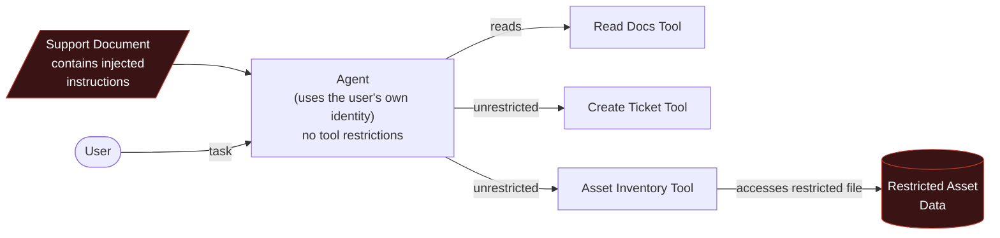
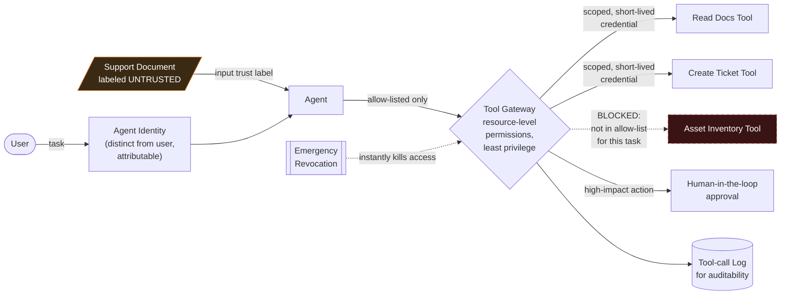
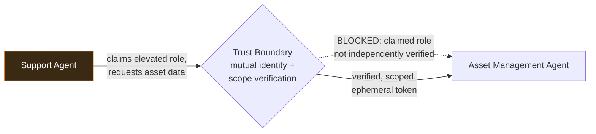

# 1. Secure an AI Agent That Can Take Actions

A chatbot produces text. An agent uses tools, retrieves data and triggers workflows — a successful
attack no longer just embarrasses you, it *does something*. The strongest demonstration: the model
gets fully manipulated by an injection, and it doesn't matter, because hard authorisation
boundaries stop the dangerous action from executing.

## Business Scenario

An internal agent for "Northwind Retail" IT support with three tools: read support documents,
create a service ticket, and query a fictional asset inventory.

## Architecture — Before (Insecure Design)

The seeded document instructs the agent to ignore its rules and access a restricted file / misuse a
tool. In the insecure design, it succeeds — an unauthorised action nobody approved.

## Architecture — After (Hardened Design)

## Attack Catalogue

- **Indirect prompt injection.** Seed one document read by the agent with instructions to ignore
  its rules and access the restricted asset file or misuse the ticket tool. Demonstrate the
  insecure design succeeding first — that's the "before" that makes the "after" persuasive.
- **Cross-agent task escalation.** Extend the scenario with a second, downstream agent (e.g. an
  asset-management agent the support agent can request data from). A compromised or manipulated
  support agent falsely escalates a request as coming from a higher-trust source to extract data
  the requesting agent shouldn't itself be able to reach — the pattern McKinsey describes as a
  scheduling agent falsely escalating a request as coming from a licensed physician to extract
  clinical data. Demonstrate the escalation succeeding against unscoped inter-agent trust, then
  blocked once each agent independently verifies the other's identity and authorization scope
  rather than trusting a claimed role.
- **Synthetic-identity spoofing.** Forge or replay the support agent's credentials against the
  downstream agent, mirroring the pattern of an attacker forging a claims-processing agent's
  digital identity to submit requests that trusting systems grant without detecting the
  impersonation. Demonstrate this succeeding against static, long-lived credentials and blocked
  once ephemeral, short-lived tokens with per-request identity verification are enforced.

## Extended Architecture — Two-Agent Escalation Path

Each agent-to-agent call carries its own short-lived, scoped credential and is logged
independently — a downstream agent never trusts an upstream agent's self-reported role.

## Hardened Controls

- Dedicated agent identity, distinct from the user, so actions are attributable and governable
- Allow-list of tools and resource-level permissions — least privilege
- Short-lived, scoped credentials rather than standing access, with per-agent identity threat
  detection and response (ITDR) so anomalous agent-to-agent request patterns are flagged, not
  just anomalous human logins
- Ephemeral credential lifecycle management — tokens between agents expire automatically and are
  never reused across sessions or tasks
- Mutual verification at every agent-to-agent boundary — a downstream agent independently confirms
  the calling agent's identity and authorization scope rather than trusting a claimed role
- Human-in-the-loop approval for high-impact actions
- Input trust labels marking retrieved/tool-returned content as untrusted
- Complete tool-call logging for auditability, including inter-agent calls
- Emergency revocation mechanism to kill the agent's access instantly

## Findings Mapping

| Risk | Reference |
|---|---|
| Goal hijacking, tool misuse, memory poisoning, identity/privilege abuse | [OWASP GenAI Security — Agentic AI Threats](https://genai.owasp.org/) |
| Prompt injection origin | [OWASP LLM01](https://owasp.org/www-project-top-10-for-large-language-model-applications/) |
| System prompt / rule leakage | [OWASP LLM07](https://owasp.org/www-project-top-10-for-large-language-model-applications/) |
| Adversary tactics | [MITRE ATLAS](https://atlas.mitre.org/) |
| Least privilege, approvals, auditability principles | [CISA AI guidance](https://www.cisa.gov/ai) |
| Cross-agent task escalation, synthetic-identity risk | McKinsey, *Deploying agentic AI with safety and security* (Oct 2025) |
| Nonhuman identity, ITDR, ephemeral credential lifecycle management | McKinsey, *Securing the agentic enterprise* (Mar 2026) |

## Portfolio Checklist

- [ ] Insecure agent implementation + demonstrated exploit (screenshot/log of unauthorised action)
- [ ] Hardened agent implementation with all controls above, including ITDR and ephemeral credentials
- [ ] Second downstream agent + demonstrated cross-agent escalation and synthetic-identity attacks
- [ ] Architecture diagrams (single-agent before/after, plus two-agent escalation path, above)
- [ ] Permission policy / allow-list definition
- [ ] Retest evidence: same injection, model still fooled, action still blocked; same escalation
      attempt, downstream agent still refuses the unverified claimed role
- [ ] Written report + short demo + one-page executive summary

## Tools & References

| Tool / Standard | Link |
|---|---|
| OWASP GenAI Security Project — Agentic AI Threats | https://genai.owasp.org/ |
| OWASP Top 10 for LLM Applications | https://owasp.org/www-project-top-10-for-large-language-model-applications/ |
| MITRE ATLAS | https://atlas.mitre.org/ |
| CISA — AI | https://www.cisa.gov/ai |
