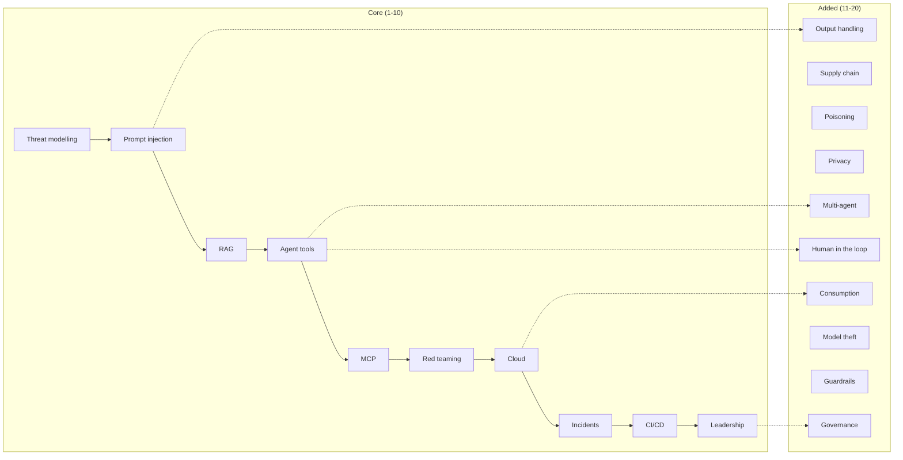

# AI Security Interview Guide

A practical, worked-answer guide to AI security interview questions. Each answer has a one-minute version, diagrams, worked examples, follow-up questions with answers, common mistakes and what to demonstrate in a portfolio.

**Questions 1 to 10** follow the ten themes of [taimurijlal/ai-security-interview-questions](https://github.com/taimurijlal/ai-security-interview-questions). The answers are original and written from scratch. **Questions 11 to 20** are additions that cover gaps. See [ATTRIBUTION.md](ATTRIBUTION.md).

## How to use it

1. Read the one-minute answer and say it aloud.
2. Study the diagram, then rebuild it from memory on a whiteboard.
3. Run or adapt the code and configuration examples.
4. Practise the follow-ups; interviewers usually go there next.
5. Build the "what to demonstrate" item and keep it in your portfolio.
6. Use [cheatsheets/mock-interview-rubric.md](cheatsheets/mock-interview-rubric.md) to score yourself.

Diagrams are Mermaid and render on GitHub.

## Overview

## Index

| # | Question | Origin | Portfolio project |
| --- | --- | --- | --- |
| 1 | [Threat model an AI application](questions/01-threat-modelling.md) | Source theme | 1 |
| 2 | [Prompt injection](questions/02-prompt-injection.md) | Source theme | 1 |
| 3 | [Secure a RAG application](questions/03-rag-security.md) | Source theme | 7 |
| 4 | [Secure an agent with tools](questions/04-agent-tool-access.md) | Source theme | 1 |
| 5 | [MCP security](questions/05-mcp-security.md) | Source theme | 2 |
| 6 | [AI red teaming](questions/06-ai-red-teaming.md) | Source theme | 4 |
| 7 | [Cloud AI security](questions/07-cloud-ai-security.md) | Source theme | 5 |
| 8 | [Incident detection and investigation](questions/08-incident-investigation.md) | Source theme | 5 |
| 9 | [AI security in CI/CD](questions/09-ai-security-cicd.md) | Source theme | 4 |
| 10 | [Explaining risk to leadership](questions/10-explaining-risk-to-leadership.md) | Source theme | 6 |
| 11 | [Improper output handling](questions/11-improper-output-handling.md) | Added | 1 |
| 12 | [AI supply chain](questions/12-ai-supply-chain.md) | Added | 3 |
| 13 | [Data and model poisoning](questions/13-data-and-model-poisoning.md) | Added | 8 |
| 14 | [Privacy and data protection](questions/14-privacy-data-protection.md) | Added | 7 |
| 15 | [Multi-agent security](questions/15-multi-agent-security.md) | Added | 1 |
| 16 | [Human in the loop](questions/16-human-in-the-loop.md) | Added | 1 |
| 17 | [Unbounded consumption](questions/17-unbounded-consumption.md) | Added | 5 |
| 18 | [Model theft and inference attacks](questions/18-model-theft-and-inference-attacks.md) | Added | 8 |
| 19 | [Guardrails](questions/19-guardrails.md) | Added | 4 |
| 20 | [Governance and standards](questions/20-governance-and-standards.md) | Added | 6 |

Project numbers match the portfolio README: 1 Secure AI Agent, 2 Secure MCP Application, 3 AI Supply Chain Security, 4 Automated Red-Teaming Lab, 5 Monitoring and Detection, 6 Governance and Assurance, 7 Secure RAG Application, 8 Model and Dataset Integrity. Where a question only loosely fits a project, the closest one is listed.

## Cheat sheets

- [Frameworks map](cheatsheets/frameworks-map.md): OWASP LLM Top 10 (2025) to questions, controls and standards.
- [Glossary](cheatsheets/glossary.md)
- [Mock interview rubric](cheatsheets/mock-interview-rubric.md)

## Repository placement

Links to portfolio projects (for example `../../01-secure-ai-agent/`) assume this folder sits at the root of the portfolio repository, as `ai-security-interview-guide/`. If you place it elsewhere, adjust those links.

## Licence

Written content is original. Choose a licence for your repository before publishing; none is included here.
