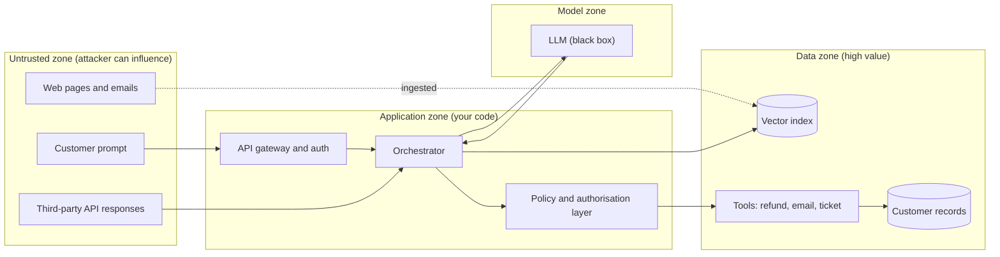

# 1. How would you threat model an AI application?

> Question adapted from [taimurijlal/ai-security-interview-questions](https://github.com/taimurijlal/ai-security-interview-questions). The answer below is original. See [ATTRIBUTION.md](../ATTRIBUTION.md).

**Portfolio link:** every project in this portfolio starts from a threat model; see especially [Project 1, Secure AI Agent](../../01-secure-ai-agent/).

## 1. The answer in one minute

I would not start by reciting the OWASP LLM Top 10. I would ask what the application does, who uses it and what it can touch. Then I would draw the architecture, mark every trust boundary, and list which inputs an attacker can control: the user prompt, retrieved documents, tool output, uploaded files. For each element I would apply STRIDE, add AI-specific attack ideas from OWASP and MITRE ATLAS, and rank the results by reachability, blast radius and the controls already present. The output is a short risk register with owners, not a list of vulnerability names.

## 2. What the interviewer is testing

A candidate who knows 50 attack names but cannot apply them to a given architecture is not yet a threat modeller. The test is whether you ask scoping questions first and whether you recognise that an AI system is a normal system with one unusual component: a model that cannot reliably tell instructions from data.

## 3. Step 1: scope the system

Ask before you draw. The answers decide the risk profile more than any technology choice does.

| Question | Why it matters |
| --- | --- |
| What is the application for, and who uses it (public, customers, staff)? | Sets the attacker population and the abuse incentives |
| What data does it read, and how sensitive is it? | Sets the confidentiality impact |
| Can it only answer, or can it act (write, send, pay, deploy)? | Separates a content risk from an action risk |
| Whose identity does it act under? | Reveals confused-deputy and privilege problems |
| Which parts are third-party (model API, MCP servers, plugins)? | Each is a supply-chain and trust relationship |
| What regulation or contract applies? | Sets the impact of a data leak |

A public FAQ bot and an agent that can issue refunds sit at opposite ends of the same architecture diagram. Saying so out loud is half the answer.

## 4. Step 2: draw the architecture and the trust boundaries

Use a data-flow diagram. Example: a customer-support assistant with retrieval and tools.

Read the diagram as a list of crossings. Every arrow that crosses a zone boundary is a place to ask three questions: who is the caller, is the request authorised, and is the data validated? The arrow from the model to the tools is the one that is new in AI systems. Nothing about it is special in terms of protocol, yet it is where model mistakes become real actions.

## 5. Step 3: list what an attacker controls

| Input | Who controls it | Trust level | Can it steer the model? |
| --- | --- | --- | --- |
| User message | The user (possibly hostile) | Untrusted | Yes, directly |
| Retrieved document | Whoever wrote or uploaded it | Untrusted unless provenance is proven | Yes, indirectly |
| Tool or API response | The remote service | Untrusted | Yes, indirectly |
| Uploaded file (PDF, image) | The uploader | Untrusted | Yes, including hidden text and image text |
| System prompt | You | Trusted, but not secret and not a control | n/a |
| Conversation memory | Earlier turns, possibly poisoned | Mixed | Yes, persistently |

The key question for every row is: what is the most damaging thing the model could be talked into doing after reading this? That is an injection impact analysis, and it is more useful than asking whether injection can happen. Assume it can.

## 6. Step 4: apply STRIDE, with an AI example for each letter

| STRIDE | Generic meaning | AI example |
| --- | --- | --- |
| Spoofing | Pretending to be someone else | A tool call made under a user's identity that the user never authorised; an MCP server impersonating a trusted one |
| Tampering | Altering data or code | A poisoned document in the knowledge base; a modified prompt template or model file |
| Repudiation | Denying an action | An agent action logged as "user" so nobody can show the agent did it |
| Information disclosure | Leaking data | Cross-tenant retrieval; secrets in the prompt; data sent to a model provider that should not have it |
| Denial of service | Making it unavailable or costly | Token flooding, recursive agent loops, a "denial of wallet" bill |
| Elevation of privilege | Gaining more power | A low-privileged user steering an over-privileged agent into admin actions |

STRIDE keeps the exercise structured. OWASP's LLM Top 10 (2025) and MITRE ATLAS then supply AI-specific attack scenarios you might not think of, such as system prompt leakage, embedding weaknesses and training-data poisoning. For agentic systems, the Cloud Security Alliance's MAESTRO framework offers a layered view that is worth knowing by name.

## 7. Step 5: prioritise into a risk register

Rank by reachability of the attacker input, blast radius if it works, and what already limits the damage. Worked example for the support assistant:

| ID | Threat | Reach | Impact | Existing control | Recommended control | Priority |
| --- | --- | --- | --- | --- | --- | --- |
| T1 | Customer-authored article carries injected instructions; agent issues a refund | High (any customer can submit) | High | None | Refund tool needs server-side policy check and a cap; approval above a limit | 1 |
| T2 | Retrieval returns another customer's documents | Medium | High | Prompt says "do not reveal others' data" | Enforce tenant and ACL filters in the retrieval query | 1 |
| T3 | Agent service account can read every table | Medium | High | None | Scope credentials per tool; read-only views | 2 |
| T4 | Third-party shipping API returns text containing instructions | Low | Medium | None | Treat as untrusted data; strict schema on output | 3 |
| T5 | Prompts with PII logged to a widely readable bucket | Medium | Medium | Log retention 365 days | Redact at source; restrict access; shorten retention | 3 |
| T6 | Loop or flood runs up model cost | Medium | Low to Medium | None | Per-user token budget, step limit, spend alarm | 4 |

Notice that most high-priority rows are conventional controls (authorisation, least privilege, quotas). That is the usual finding.

## 8. Step 6: keep it alive

A threat model rots the day the architecture changes. Define triggers that force an update: a new tool, a new data source, a change of model or provider, a new tenant type, a new MCP server, a change in who can upload documents. Store the model as code (for example in a repository with a tool such as OWASP pytm or Threat Dragon), review it in design reviews, and link each mitigation to an automated test so a regression is caught in CI. Phase 3 of the Secure AI Agent walkthrough shows exactly that pattern.

## 9. Follow-up questions, with answers

**Where exactly is the trust boundary between retrieved context and the model?**
Inside the context window there is no boundary: the model sees one stream of tokens and cannot reliably separate your instructions from a document's. So the boundary has to be built around the model. Control what is allowed to enter the context (retrieval authorisation, ingestion vetting), and control what is allowed to leave it as an action (a policy layer between the model and every tool). Delimiters and "the following is untrusted data" labels are useful as a weak signal, but they are not a boundary.

**Which threat would you fix first, and why?**
The one with the best ratio of risk reduced to effort, which is usually broken authorisation on retrieval or over-privileged tool credentials. Both are deterministic and testable, and fixing them caps the damage of the probabilistic threats such as injection. Fixing injection itself is the hardest item on the list, so I would not wait for it before reducing the blast radius.

**How does the model change when the assistant gets a tool that writes data?**
The risk class changes from confidentiality to integrity and action. New concerns appear: irreversible effects, confused-deputy abuse, duplicate or runaway actions and repudiation. I would add idempotency keys, caps, approval tiers, rollback or compensation paths, per-action audit logging and a revocation switch. I would also rerun the threat model, because the lethal-trifecta test (private data plus untrusted content plus an outward channel) may now be satisfied.

**How would you keep the threat model current?**
Tie it to change triggers (see section 8), keep it in version control next to the code, and tie each mitigation to a test that runs in CI. Re-review after every incident and every red-team finding.

**How do you threat model a model you cannot inspect, such as a third-party API?** *(added)*
Treat it as an untrusted, black-box component. Assume its output can be wrong, manipulated or adversarial, so validate and constrain it as you would any external input. Assume anything you send it leaves your control, so apply data minimisation, contractual limits on retention and training, and region controls. Add provider change (model updates, deprecations) to your change triggers, because behaviour can shift without a code change on your side.

**Why STRIDE rather than another method?** *(added)*
STRIDE is quick to teach and maps cleanly onto data-flow diagrams, which is why it is a common default. PASTA is better when you need a business-risk-driven process, attack trees help when you are analysing one specific goal in depth, and MAESTRO adds agent-specific layers. In an interview, say which you would choose and why for this case; the method matters less than applying one consistently.

## 10. Common mistakes

1. Reciting the OWASP list without tying each item to a component in the diagram.
2. Treating the model as the only thing worth modelling and ignoring IAM, APIs and data stores.
3. Producing a one-off document that nobody revisits.
4. Rating every finding "critical", which hides the two that matter.

## 11. What to demonstrate

A short threat model for a small RAG-plus-tools application: data-flow diagram with boundaries, trust table, STRIDE-based register with priorities, and at least two threats linked to automated tests.
