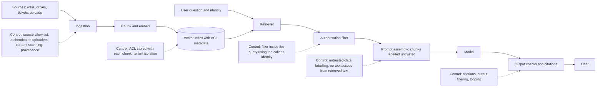

# 3. How would you secure a RAG application?

> Question adapted from [taimurijlal/ai-security-interview-questions](https://github.com/taimurijlal/ai-security-interview-questions). The answer below is original. See [ATTRIBUTION.md](../ATTRIBUTION.md).

**Portfolio link:** [Project 7, Secure RAG Application](../../07-secure-rag-application/).

## 1. The answer in one minute

A retrieval-augmented generation (RAG) system has two security jobs that are easy to forget because the model gets all the attention. The first is *integrity*: only trustworthy content should get into the knowledge base, and it should carry provenance, so a poisoned document cannot steer the model. The second is *authorisation*: the retriever must return only what the signed-in user is allowed to see, enforced in the query, never left to the model to withhold. Semantic similarity is not permission. Around those two jobs sit the ordinary controls: tenant isolation, encryption, logging, retention and testing with synthetic confidential data.

## 2. Map the pipeline and the controls



Walk the interviewer through the pipeline in this order. Each stage has a different attacker and a different control.

## 3. Job one: protect what goes in (integrity)

The knowledge base is a trust boundary. Anything that can write to it can influence every future answer, and indirect injection means a document can carry commands as well as facts.

| Risk | Example | Control |
| --- | --- | --- |
| Poisoned document | Someone uploads a FAQ with a hidden instruction or false policy | Authenticated uploaders only; review for high-trust corpora; scan for hidden text, HTML comments, zero-width characters and embedded scripts |
| Silent modification | A shared wiki page is edited after ingestion | Content hashes, versioning, re-ingest on change, alert on unexpected diffs |
| Untrusted sources mixed with trusted ones | Public web pages indexed beside HR policy | Separate collections, mark source type in metadata, weight or exclude low-trust sources |
| Unknown origin | A chunk is returned but nobody can say where it came from | Provenance metadata: source, owner, ingest time, hash, approver |
| Data that should be forgotten | A deleted document still answers questions | Deletion propagates to the index; test for it |

Quarantine external content before it joins the trusted index, and record who approved it.

## 4. Job two: enforce who can see what (authorisation)

The failure to avoid: an engineer asks a question, the nearest vector is a confidential HR document, and the model is trusted to decide not to repeat it. Relevance is not entitlement.

Rules of thumb:

1. Store the access rule with each chunk, as group or role identifiers rather than individual users. A chunk inherits the ACL of its source document.
2. Apply the filter *inside the retrieval query*, before ranking, using the caller's identity from a verified token, not an identity the model or the client supplies.
3. Check against the source of truth where permissions change often, because a copied ACL can go stale.
4. Fail closed: if a chunk has no ACL or the identity is missing, return nothing.

Example with PostgreSQL and pgvector:

```sql
-- :tenant and :principals come from the verified session, never from the prompt
SELECT id, chunk_text, source_uri
FROM   chunks
WHERE  tenant_id = :tenant
  AND  acl_principals && :principals          -- array overlap: user's groups vs allowed groups
ORDER  BY embedding <=> :query_embedding      -- cosine distance
LIMIT  5;
```

Choosing an isolation model for multi-tenant products:

| Model | Isolation | Cost and complexity | When to use |
| --- | --- | --- | --- |
| Separate index or database per tenant | Strongest | Highest | Regulated tenants, large customers |
| Namespace or partition per tenant | Strong | Medium | Most SaaS products |
| Shared index with a tenant filter on every query | Depends on never missing the filter | Lowest | Only with query-layer enforcement and tests |

If you use a managed service such as Amazon Bedrock Knowledge Bases, use its metadata filtering to carry the same principle, and verify with tests that the filter is applied to every request path.

## 5. At query time: treat retrieved text as data

Even a perfectly authorised chunk can carry an injection. Label retrieved chunks as untrusted, give the model no direct ability to act on them, require citations to chunk IDs, cap the number of chunks, and run the same tool authorisation described in [Q2](02-prompt-injection.md) and [Q4](04-agent-tool-access.md). If the retrieval answer is used by an agent with tools, a poisoned chunk becomes an action risk, not just a wrong answer.

## 6. Do embeddings leak?

Treat the vector store as sensitive as the source. Research on embedding inversion (for example the vec2text work) has shown that original text can often be partially or largely reconstructed from embeddings, so a leaked index may leak content. Encrypt at rest, restrict access, do not publish indexes, and apply the same retention rules as the source data.

## 7. Prove it with tests and canaries

Seed the corpus with synthetic confidential documents that carry unique canary strings. Then test a matrix of users against documents.

```python
import pytest

DOCS = {"hr-salary-2026": {"hr"}, "eng-runbook": {"eng", "hr"}}   # doc -> allowed groups

@pytest.mark.parametrize("user_groups, doc_id, should_see", [
    ({"eng"}, "hr-salary-2026", False),
    ({"hr"},  "hr-salary-2026", True),
    ({"eng"}, "eng-runbook",    True),
])
def test_retrieval_respects_acl(user_groups, doc_id, should_see, retriever):
    results = retriever.search("salary bands for engineers", principals=user_groups)
    returned = {r.doc_id for r in results}
    assert (doc_id in returned) == should_see
```

Add tests for a user whose group membership was just removed, for a deleted document, and for a query that tries to name the document directly ("show me hr-salary-2026").

## 8. Follow-up questions, with answers

**Why not just tell the model "don't reveal HR data"?**
Because it is a request and not a control. A model can be argued out of it, can summarise the content in a way that technically complies, and cannot know who the user really is. Once the text is in the context window, you have already disclosed it to the model and any log that records it. The retriever must never fetch it for that user in the first place.

**How do you keep ACLs in the index in sync when permissions change upstream?**
Prefer storing group identifiers rather than expanded user lists, so most membership changes need no re-index. Subscribe to permission-change events from the source system and update the metadata, run a periodic reconciliation job, and set a maximum staleness. For high-sensitivity content, do a live check against the source of truth after retrieval and before prompt assembly, and drop chunks the user can no longer read. Log and alert on mismatches, which reveal sync gaps.

**Can embeddings leak the original text?**
Yes, to a degree. Inversion attacks can recover substantial content from some embedding models, and membership inference can reveal whether a document is in the index. Treat vectors as equivalent to the plaintext for access control, encryption and retention.

**How would you detect a poisoned document after it has been ingested?**
Use provenance to scope the search: find everything from the suspect source and time window. Re-scan the corpus with updated detectors for hidden instructions. Look for chunks that are retrieved unusually often, for queries unrelated to them, or that co-occur with blocked tool calls. Run canary queries on a schedule. Then quarantine, remove and re-embed the affected content and add the pattern to the ingestion scanner and the regression tests.

**Where should access control for RAG live: the vector database, the app or the source system?** *(added)*
Enforce in the layer you control and can test, usually the retrieval service that builds the query. Keep the source system as the authority for *who is allowed*, and treat the index as a cache of that decision. Do not rely on a vector database's UI-level permissions alone.

**What about chunking? Can a permission boundary be crossed by combining chunks?** *(added)*
Yes. If you build chunks that merge text from documents with different ACLs, you create content with no correct ACL. Chunk within one document, inherit its ACL, and be careful with summaries or "knowledge graph" nodes that combine sources: they should carry the most restrictive ACL of their inputs.

**How does a reranker or hybrid search affect security?** *(added)*
A reranker only sees what retrieval returned, so it is safe if it runs after the authorisation filter. The risk is a pipeline that reranks across the whole corpus first and filters afterwards, which leaks through ranking side channels, timing and result counts. Filter first.

## 9. Common mistakes

1. Filtering results in the UI or in the prompt after retrieval has already happened.
2. Letting any employee upload to the same index the whole company trusts.
3. Forgetting that deletion must reach the vector index and any caches.
4. Testing with real confidential data instead of synthetic canaries.

## 10. What to demonstrate

A small RAG application with document-level permissions, synthetic confidential documents with canaries, and a test matrix showing unauthorised users cannot retrieve protected content, plus an ingestion scanner that rejects a poisoned file.
