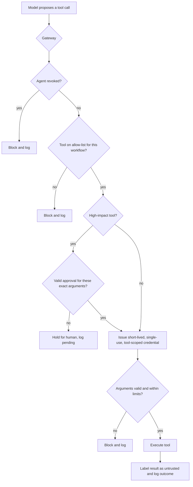

# 4. How would you secure an AI agent with access to tools?

> Question adapted from [taimurijlal/ai-security-interview-questions](https://github.com/taimurijlal/ai-security-interview-questions). The answer below is original. See [ATTRIBUTION.md](../ATTRIBUTION.md).

**Portfolio link:** [Project 1, Secure AI Agent](../../01-secure-ai-agent/) implements the gateway, allow-list, single-use credentials, approval and revocation described here, with 14 per-control checks.

## 1. The answer in one minute

The danger of an agent is not that it can be wrong. It is that it can turn a wrong or manipulated decision into a real action. So I control the authority it holds rather than trusting its judgement. I give it its own identity and the minimum permissions for the workflow, put every tool call through a gateway that enforces policy outside the model, split actions into autonomy tiers (read-only runs freely, privileged actions need independent approval), use short-lived scoped credentials, cap steps and spend, log everything including blocked attempts, and build a tested kill switch.

## 2. Step 1: inventory what the agent can do

Start with a capability list and rate the worst case of each tool.

| Capability | Example | Worst case | Default stance |
| --- | --- | --- | --- |
| Read, narrow scope | Query one table through a view | Disclosure of that data | Allow, with scoping |
| Read, broad scope | Search all company mailboxes | Large-scale disclosure | Approval or deny |
| Write, reversible | Create a ticket, draft an email | Noise, mild fraud | Allow with caps |
| Write, irreversible | Send email, delete data, pay | Real harm | Approval, caps, audit |
| Code execution | Run a script | Anything the sandbox allows | Sandboxed, no secrets, no network by default |
| Control plane | Change IAM, firewall, production config | Account takeover | Deny for the agent; human or pipeline does it |

## 3. Step 2: decide whose identity the agent uses

| Option | How it works | Problem |
| --- | --- | --- |
| Agent runs as the user | Reuses the user's session | Agent actions look like the user's; a hijacked agent produces false evidence against a person |
| Agent has one powerful service account | A shared role for every task | Every user inherits the agent's full power (confused deputy) |
| Agent has its own identity and acts on behalf of the user | Own principal, plus a delegated token (OAuth on-behalf-of) | More plumbing, but accountable |

My answer: the agent gets its own identity, and each action is allowed only if it falls within the *intersection* of the agent's role and the requesting user's rights. The audit log then records both: "agent X acting for user Y".

This is the "borrowed identity" weakness demonstrated in the Secure AI Agent project: the insecure version logs `user:alice` against a call that Alice never made, while the hardened version logs `agent:support-assistant-001`.

## 4. Step 3: put a gateway between the model and the tools



The order matters. Cheap, non-negotiable checks run first (revoked, not allowed), judgement-based checks later. Every branch writes a log entry, including the blocked ones: a blocked call is a detection signal.

## 5. Step 4: autonomy tiers, so approval stays meaningful

Requiring a human for everything makes the agent useless and trains people to click "yes". Tier the actions instead.

| Tier | Examples | Control |
| --- | --- | --- |
| 0 Automatic | Read narrow data, search docs | Scoped credentials, logging |
| 1 Automatic with caps | Create ticket, draft message | Rate and value limits, idempotency keys |
| 2 Approval required | Send external email, refund above a limit, change a record | Human approves the *exact* call, single use, time-limited |
| 3 Never for the agent | Change IAM, delete production data, disable logging | Deny; routed to a human or a change pipeline |

## 6. Step 5: credentials, limits and the kill switch

Credentials: mint short-lived, tool-scoped tokens per call or per task. On AWS, use `sts:AssumeRole` with a session policy that narrows the role further, and a short duration. Never place long-lived keys in the prompt or the agent's environment.

Limits: maximum steps per task, maximum tool calls per minute, per-user token and spend budgets, wall-clock timeouts, and loop detection (the same call with the same arguments three times in a row stops the run).

Kill switch, in practice:

1. A central "agent enabled" flag read by the gateway on every call, so a flip takes effect within seconds.
2. Revocation of the agent's credentials and, where needed, the role's trust policy.
3. Per-tool and per-tenant circuit breakers, so you can disable one capability without taking the product down.
4. A runbook and a drill: test the switch quarterly, because an untested kill switch is a hope.

## 7. Worked example: an agent that investigates AWS security findings

The agent may read logs and findings and propose fixes. It must never apply them itself.

```json
{
  "Version": "2012-10-17",
  "Statement": [
    {
      "Sid": "ReadOnlyInvestigation",
      "Effect": "Allow",
      "Action": [
        "securityhub:GetFindings",
        "logs:FilterLogEvents",
        "logs:GetLogEvents",
        "ec2:DescribeInstances",
        "ec2:DescribeSecurityGroups"
      ],
      "Resource": "*"
    },
    {
      "Sid": "HardDenyControlPlane",
      "Effect": "Deny",
      "Action": [
        "iam:*",
        "ec2:AuthorizeSecurityGroupIngress",
        "ec2:DeleteSecurityGroup",
        "ec2:TerminateInstances",
        "cloudtrail:StopLogging",
        "cloudtrail:DeleteTrail"
      ],
      "Resource": "*"
    }
  ]
}
```

In production, narrow the `logs:` actions to specific log group ARNs rather than `*`. The agent's output is a *change proposal*. A separate, gated process (a ticket, a pipeline job or a workflow with a manual approval step) applies it. The explicit `Deny` matters because it survives a mistake in an allow policy elsewhere.

## 8. Step 6: test the realistic failures

| Scenario | Expected result |
| --- | --- |
| A document tells the agent to open a security group to the internet | Call denied by the role and by the gateway; attempt logged |
| The agent calls the same tool 50 times in a loop | Loop detector or rate limit stops it |
| A compromised integration asks the agent to call a more privileged tool | Tool not on the allow-list; credential not issued |
| Approval for a refund of 50 dollars is replayed for 5,000 dollars | Rejected: approval bound to exact arguments, single use |
| The kill switch is flipped mid-task | Next call blocked, task ends with a clear reason |

## 9. Follow-up questions, with answers

**Where does the policy engine run, and what stops the agent from bypassing it?**
It runs outside the model, in a separate process or service that the agent cannot modify, ideally with its own identity. The agent holds no tool credentials: only the gateway does, and it only releases them after a decision. Network rules should make the gateway the only path to the tools, so a model that is somehow tricked into calling the tool directly has nowhere to go. Policy engines such as Open Policy Agent or Cedar make rules declarative and testable.

**How do you avoid approval fatigue, where humans click "yes" on everything?**
Tier actions so only meaningful ones reach a human, show the raw parameters rather than a model-written summary, make the approval specific and single-use, rate-limit approvals per person, and measure approval rates and times to spot rubber-stamping. See [Q16](16-human-in-the-loop.md) for the full treatment.

**Should the agent act with the user's permissions, its own, or the intersection?**
The intersection. The user's rights alone give you no containment; the agent's rights alone let a low-privileged user borrow its power. Implement with delegated tokens and check both at the gateway.

**How would you implement the kill switch in practice?**
See section 6: a central flag read on every call, credential revocation, per-tool circuit breakers, and a drill. State the target time to contain (for example under a minute) and test it.

**How do you sandbox an agent that executes code?** *(added)*
Run it in an isolated environment such as a microVM or gVisor sandbox with a read-only base image, a scratch filesystem that is destroyed afterwards, no ambient credentials, no network by default (or an egress proxy with an allow-list), and CPU, memory and time limits. Treat generated code as untrusted input.

**How do you stop privilege escalation by chaining tools?** *(added)*
Authorise every call independently, with the provenance of its arguments considered. No tool should be able to mint, widen or extract credentials. Check the combined effect of sequences (for example "read secrets" followed by "send external email") with policy rules, and prefer coarse tools with narrow functions over one general "run anything" tool.

**Single agent versus multi-agent: does anything change?** *(added)*
Yes. Messages between agents are a new injection channel, and delegated authority can grow at each hop. See [Q15](15-multi-agent-security.md).

## 10. Common mistakes

1. Securing the prompts and forgetting identity and permissions.
2. Requiring approval for everything, then wondering why people stop reading the prompts.
3. Giving the agent a broad role "for convenience" and relying on instructions to behave.
4. Logging only successful calls.

## 11. What to demonstrate

An agent that runs approved read-only operations on its own and needs independent, single-use approval for privileged changes, with logs that show the blocked attempt and a tested kill switch.
