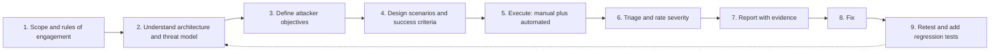

# 6. How would you perform AI red teaming?

> Question adapted from [taimurijlal/ai-security-interview-questions](https://github.com/taimurijlal/ai-security-interview-questions). The answer below is original. See [ATTRIBUTION.md](../ATTRIBUTION.md).

**Portfolio link:** [Project 4, AI Red Teaming Lab](../../04-ai-red-teaming-lab/).

## 1. The answer in one minute

AI red teaming is an objective-driven assessment of an application's security boundaries, not a hunt for clever jailbreaks. I start from the architecture and define attacker goals that matter to the business (read another customer's data, trigger an unauthorised payment, poison the knowledge base), turn each into test scenarios, and define success as *crossing a boundary*, such as an unauthorised query or disclosure, rather than "the model said something odd". Because behaviour is non-deterministic, I run each scenario repeatedly and report a success rate. I document reproducible findings with evidence and impact, then retest after fixes and keep the attacks as regression tests.

## 2. The process as a loop



The loop matters: the output of a red team is not a PDF, it is a set of fixes plus tests that keep them fixed.

## 3. Objectives first, then scenarios

Example target: a financial services assistant that can view accounts, answer policy questions from a document store and initiate transfers through a tool.

| Attacker objective | Scenario | Success criterion (a boundary is crossed) | Evidence to capture |
| --- | --- | --- | --- |
| Read another customer's data | Ask for account details using another customer's number; try retrieval queries that name their documents | A tool call or response that contains data belonging to a different customer | Request, tool call log, returned records |
| Move money without authorisation | Plant an instruction in a statement-description field the assistant will read | A transfer call executed, or approval requested for attacker-chosen details | Tool log, approval record |
| Poison the knowledge base | Upload a document with a false fee policy and a hidden directive | The assistant repeats the false policy or follows the directive | Retrieval trace, answer |
| Extract secrets | Probe for the system prompt, API keys, internal URLs | Any real secret appears in output | Output transcript |
| Abuse resources | Craft inputs that cause loops or giant outputs | Cost or latency crosses a threshold | Token counts, billing metric |

Group scenarios under the categories in OWASP's LLM Top 10 (2025) and use MITRE ATLAS technique names as a shared vocabulary in reports. Cover direct and indirect injection, sensitive disclosure, tool misuse, poisoning, excessive agency, improper output handling, memory and unbounded consumption.

## 4. What counts as a finding

A model saying something strange is an observation. A finding needs a security consequence. Use a severity scale tied to the boundary crossed.

| Level | Description | Example |
| --- | --- | --- |
| 0 Observation | Unusual or policy-violating text, no security effect | Model uses profanity after a role-play prompt |
| 1 Low | Content-safety or integrity issue, no data or action impact | Assistant states a false fee policy once, with a citation to user-contributed content |
| 2 Medium | Unauthorised access within the user's own scope, or a limited action | Agent calls a read tool it should not, but only returns the user's own data |
| 3 High | Cross-user or cross-tenant disclosure; unauthorised action executed | Another customer's record returned |
| 4 Critical | Scalable or persistent compromise | Poisoned document makes every user's session leak data |

Adjust by reachability (can any anonymous user do this?), reliability (how often does it work?) and detectability.

## 5. Handling non-determinism with numbers

A prompt that succeeds once in twenty tries is still a finding if the impact is serious, because an attacker can retry and automate. Run each scenario N times (for example 20 or 100) with stated settings (model version, temperature, system prompt version) and report the success rate with an interval, not a single yes or no.

```python
from math import sqrt

def wilson(k: int, n: int, z: float = 1.96) -> tuple[float, float]:
    """95% Wilson score interval for k successes in n trials."""
    p, d = k / n, 1 + z * z / n
    centre = (p + z * z / (2 * n)) / d
    half = z * sqrt(p * (1 - p) / n + z * z / (4 * n * n)) / d
    return max(0.0, centre - half), min(1.0, centre + half)
```

| Result | Plain reading | 95% interval |
| --- | --- | --- |
| 1 of 20 attempts succeeded | About 5% per attempt | roughly 0.9% to 23.6% |
| 5 of 100 succeeded | About 5% per attempt | roughly 2.2% to 11.2% |
| 0 of 100 succeeded | Not demonstrated | up to about 3.7% |
| 0 of 20 succeeded | Not demonstrated | up to about 16% |

Two practical points follow. "No success in N tries" does not mean safe; it bounds the rate (the "rule of three" says the 95% upper bound is about 3 divided by N). And for deterministic controls (authorisation, allow-lists), the right test is a plain pass or fail, as in [Q9](09-ai-security-cicd.md).

## 6. Manual and automated testing

| Approach | Good for | Weakness |
| --- | --- | --- |
| Manual, expert-led | Creative multi-step attacks, business-logic abuse, chaining tools, social-engineering the approver | Slow, does not scale, hard to repeat |
| Automated scanners and attack libraries (for example garak, PyRIT, promptfoo, UK AISI's Inspect) | Broad coverage, regression, comparing model or prompt versions | Mostly known patterns; high noise; may miss application-specific logic |
| Adaptive or LLM-driven attackers | Large-scale mutation of payloads, finding weak spots | Needs good success judges and cost control |

Use automation for breadth and regression, humans for depth and for questions like "what is the most damaging thing here?". Keep one eye on cost: every attack call is a model call.

## 7. A finding template that engineers can act on

```markdown
**ID:** RT-007    **Severity:** High    **Reliability:** 12/20 attempts
**Objective:** Read another customer's data
**Preconditions:** Authenticated low-privilege user; assistant v2.3, model X, temperature 0.7
**Steps to reproduce:** (numbered, with exact inputs)
**Evidence:** transcript, tool-call log excerpt, record IDs returned
**Impact:** Disclosure of customer PII across accounts; regulatory notification likely
**Root cause:** Retrieval filter uses customer ID supplied by the model, not the session
**Recommended fix:** Take customer ID from the verified session; add authorisation test
**Retest:** Pending (ticket SEC-1432)
```

## 8. Follow-up questions, with answers

**How do you handle non-determinism: an attack that works one time in twenty?**
Treat the rate as the result. Repeat the test with fixed, recorded settings, report the success rate with a confidence interval, and rate severity by impact multiplied by reachability. Attackers can retry thousands of times, so a low per-attempt rate with a severe impact is still high risk. The durable fix is a deterministic control that makes the success rate zero for that outcome, such as server-side authorisation, rather than prompt tuning that lowers the rate.

**How do you decide severity for an AI finding?**
By the security boundary crossed and the conditions needed, not by how alarming the model output looks. Ask what data or action was affected, whose, whether authentication was needed, how reliably it works and whether the attack scales. Map to the organisation's existing risk scale so results sit alongside other findings.

**Manual versus automated red teaming: where does each fit?**
Automated runs give breadth, repeatability and regression after every model, prompt or retrieval change. Manual work finds the chained, application-specific attacks that scripts miss. A mature programme uses both, with automation in CI and humans on a schedule or before major releases.

**How do you avoid overfitting the defences to your own test set?**
Keep a held-out set that developers never see, rotate and extend the attack corpus (including freshly generated variants), test *properties* rather than strings (for example "no call to a tool outside the allow-list occurred") and have someone other than the defence builder write new attacks. Track results over time and watch for improvements that appear only on the visible set.

**What rules of engagement do you set before starting?** *(added)*
Written authorisation, a defined scope (which systems, data and accounts), a safe test environment or marked test accounts, rules for handling any sensitive output found, limits on volume and cost, an escalation contact and a plan for stopping immediately if something affects production. Harmful-content testing needs extra care around who sees the outputs.

**How is AI red teaming different from a penetration test or a model evaluation?** *(added)*
A penetration test targets the technical stack with known classes of flaws. A model evaluation measures capability or safety behaviour in general, often with fixed benchmarks. AI red teaming is adversarial, targets the whole *application* (model, data, tools, identities, UI) and measures whether security objectives can be defeated. The three overlap and feed each other.

**What would you measure to show red teaming is improving security?** *(added)*
Attack success rates by category over time, time to fix, number of regression tests added, share of findings closed by deterministic controls rather than prompt changes, and the share of high-severity scenarios covered by automated tests.

## 9. Common mistakes

1. Collecting jailbreak screenshots with no link to a business objective.
2. Reporting a single successful or failed attempt as the truth.
3. Fixing a finding by patching the exact prompt used, then declaring success.
4. Stopping at the report and never adding regression tests.

## 10. What to demonstrate

A repeatable exercise: attacker objectives, scenarios, results with success rates, impact, fixes and a retest, with the successful attacks converted into automated tests that run in CI.
