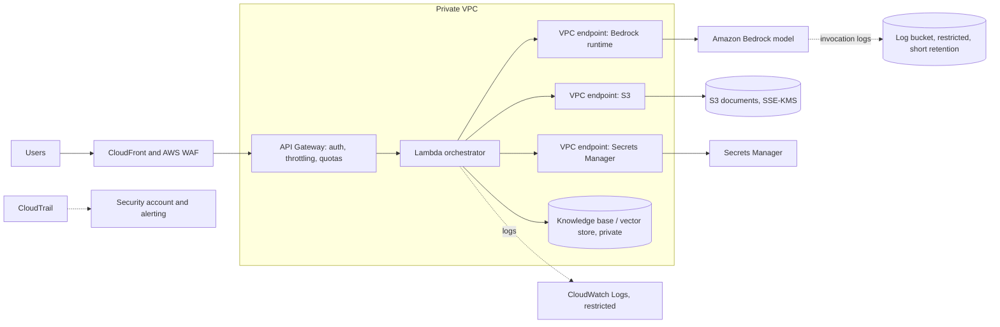

# 7. How would you secure AI models and data in the cloud?

> Question adapted from [taimurijlal/ai-security-interview-questions](https://github.com/taimurijlal/ai-security-interview-questions). The answer below is original. See [ATTRIBUTION.md](../ATTRIBUTION.md).

**Portfolio link:** [Project 3, AI Supply Chain Security](../../03-ai-supply-chain-security/) and [Project 8, Model and Dataset Integrity](../../08-model-dataset-integrity/) cover the model and data side of this answer.

## 1. The answer in one minute

Cloud AI security is cloud security plus a few new attack paths. I would review the architecture and apply the normal disciplines: least-privilege IAM per component, private networking, encryption with managed keys, secrets management, logging with care about what the logs contain, edge protection, and cost controls. Then I would add the AI-specific checks: untrusted documents influencing behaviour, model output flowing into downstream systems without validation, agents sharing an over-broad role, and cross-region or provider data handling. Using a managed model service does not transfer responsibility; it only moves the line.

## 2. Shared responsibility for a managed model service

| Layer | Cloud provider | You |
| --- | --- | --- |
| Physical and host infrastructure | Yes | No |
| Model hosting and runtime of the managed service | Yes | No |
| Service-side commitments (for example, not training the provider's models on your prompts) | Yes, per the service terms, which you must read and confirm | Verify and document |
| Identity and access (who can invoke which model) | Provides the tools | Yes |
| Your data: classification, encryption keys, retention | Provides the tools | Yes |
| Network paths and egress | Provides the tools | Yes |
| Application logic, prompts, tool permissions, output handling | No | Yes |
| Guardrail and content-filter configuration | Provides the feature | Yes |
| Logging, monitoring and response | Provides the tools | Yes |

## 3. A reference architecture on AWS



## 4. A review checklist, area by area

| Area | What to check | Typical finding | Fix |
| --- | --- | --- | --- |
| Identity | Function role allows `bedrock:InvokeModel` only on named model ARNs | `bedrock:*` on `Resource: *` | Scope actions and resources; add permission boundaries |
| Identity | Separate roles for the orchestrator, the ingestion job and any agent | One shared role | Split by function |
| Identity | Organisation guardrails (SCPs) restrict regions and services | Anyone can enable any model anywhere | Deny outside approved regions and models |
| Data | S3 Block Public Access, SSE-KMS with a reviewed key policy, TLS-only bucket policy | Default encryption but an open key policy | Tighten key and bucket policies |
| Data | Retention for prompts, outputs, embeddings and caches | Indefinite retention "for debugging" | Define and enforce lifecycle rules |
| Network | Private endpoints to model, storage and secrets; no public vector database | Public egress from the function; open security group | Endpoints, private subnets, egress allow-list |
| Secrets | Secrets Manager with rotation; nothing in environment variables or prompts | API keys in function config | Move and rotate |
| Logging | CloudTrail on in all regions; model invocation logging to a restricted, encrypted destination | Prompts containing PII in a broadly readable bucket | Restrict, encrypt, shorten retention, redact |
| Edge | Authentication, WAF, throttling and quotas on the API | Anonymous endpoint with no rate limit | Add all three |
| Cost | Budgets, anomaly detection, token caps | Nothing alerts on a spend spike | Add alarms and per-user quotas |
| AI-specific | Model output validated before reaching SQL, shell, APIs or HTML | Generated text executed directly | Schema validation, parameterisation, encoding |
| AI-specific | Region and cross-region inference behaviour documented | Requests silently processed in another region | Choose profiles and regions to match data residency |
| AI-specific | Agents: own role, tool allow-list, approval for writes | Agent shares the application's broad role | See [Q4](04-agent-tool-access.md) |

## 5. Concrete examples

A least-privilege policy for the orchestrator function (replace the placeholders):

```json
{
  "Version": "2012-10-17",
  "Statement": [
    {
      "Effect": "Allow",
      "Action": "bedrock:InvokeModel",
      "Resource": "arn:aws:bedrock:<region>::foundation-model/<approved-model-id>"
    },
    {
      "Effect": "Allow",
      "Action": "s3:GetObject",
      "Resource": "arn:aws:s3:::<docs-bucket>/approved/*"
    }
  ]
}
```

A bucket policy statement that refuses non-TLS access to the same bucket:

```json
{
  "Sid": "DenyInsecureTransport",
  "Effect": "Deny",
  "Principal": "*",
  "Action": "s3:*",
  "Resource": ["arn:aws:s3:::<docs-bucket>", "arn:aws:s3:::<docs-bucket>/*"],
  "Condition": { "Bool": { "aws:SecureTransport": "false" } }
}
```

For a vulnerable-to-fixed comparison, show the orchestrator before (wildcard actions, public egress, keys in environment variables) and after (the two statements above, endpoints, Secrets Manager), and link each change to a threat in the model from [Q1](01-threat-modelling.md).

## 6. Logging: a decision, not a default

Model invocation logging is valuable for investigation ([Q8](08-incident-investigation.md)) but it records prompts and completions, which may hold personal data and secrets. CloudTrail records that an API call happened, not its content. My approach: enable invocation logging, send it to a dedicated bucket with KMS encryption, tight access, a short, justified retention period and redaction where feasible, and treat read access to it as privileged. Record the decision and its owner.

## 7. Cost abuse and denial of wallet

An unauthenticated or lightly protected endpoint lets an attacker, or a runaway agent loop, generate large model bills. Layer the defences: authentication, per-user rate limits and daily token budgets in the application, API Gateway throttling and usage plans, WAF rate rules, output token caps, step limits for agents, AWS Budgets and anomaly detection with alarms that page someone, and quotas on the account. Test the alarm by simulating a spike.

## 8. Follow-up questions, with answers

**Should you enable model-invocation logging, given it captures sensitive prompts?**
Yes in most environments, because without it an AI incident is hard to reconstruct, but design it as a sensitive data store: dedicated encrypted destination, narrow access, short retention, redaction at source where possible, and a data-protection assessment. Where content logging is unacceptable, log metadata (who, model, token counts, tool calls, decisions) and keep full content only for sampled or flagged traffic.

**How would you stop a compromised function from running up a huge Bedrock bill?**
Limit the blast radius in advance: a least-privilege role restricted to approved models, a service quota or budget that caps spend, and an alarm tied to an automated response such as removing the invoke permission or throttling the function. Combine this with per-user and per-tenant limits inside the application and alerts on abnormal token usage.

**What does shared responsibility look like for a managed LLM service?**
See section 2. The provider secures the service; you secure what you put in, who can call it, how it is configured, where the data goes and what you do with its output. The common mistake is assuming the provider's controls cover your prompts, your IAM and your application logic.

**How would you detect a poisoned file landing in the S3 ingestion bucket?**
Make the ingestion bucket write-only from the uploader's perspective and never feed the index directly from it. An S3 event triggers a scanning step: malware scan, file-type and structure checks, hidden-text and instruction detection, PII detection (for example with Amazon Macie), and a provenance check on who uploaded it. Clean files move to the approved prefix that ingestion reads; suspicious ones go to a quarantine bucket with an alert. Log hashes so you can find and remove the same content later.

**How do you secure a custom or fine-tuned model in SageMaker or similar?** *(added)*
Treat training data and model artefacts as crown jewels: private subnets and endpoints, KMS-encrypted storage, no public notebooks, signed and versioned artefacts in a controlled registry, access restricted to the training role, and reproducible pipelines. Scan third-party base models and dependencies before use (see [Q12](12-ai-supply-chain.md)).

**How do you keep sensitive data out of prompts in the first place?** *(added)*
Minimise: send only fields the task needs. Classify and tokenise or mask identifiers before the call, apply PII detection on input (for example Bedrock Guardrails sensitive-information filters or a dedicated detector), and block categories that must never leave. Verify with test data that contains canaries. See [Q14](14-privacy-data-protection.md).

**How would you structure accounts?** *(added)*
Separate accounts for production, development and security tooling, with organisation-level SCPs, centralised logging into a security account, and a dedicated account or environment for experimentation with synthetic data only.

## 9. Common mistakes

1. Assuming the managed service handles IAM, networking and logging for you.
2. Logging full prompts to a bucket that many staff can read.
3. Treating model output as safe to pass into SQL, shell commands or HTML.
4. Forgetting that agents and ingestion jobs need their own roles.

## 10. What to demonstrate

A cloud security review of a small AI application, with findings on permissions, data exposure, network paths and AI-specific attack paths, a before-and-after policy diff and a cost-abuse test.
