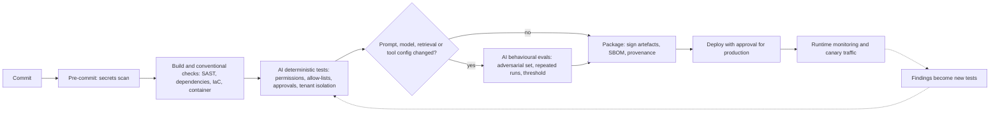

# 9. How would you integrate AI security into CI/CD?

> Question adapted from [taimurijlal/ai-security-interview-questions](https://github.com/taimurijlal/ai-security-interview-questions). The answer below is original. See [ATTRIBUTION.md](../ATTRIBUTION.md).

**Portfolio link:** Phase 3 of [Project 1](../../01-secure-ai-agent/) builds a working version: an attack runner that exits non-zero if the defence fails, a pytest suite and a GitHub Actions gate.

## 1. The answer in one minute

AI security belongs in the pipeline in layers. Conventional checks come first: secrets scanning, static analysis, dependency and container scanning, infrastructure-as-code validation. On top of them I add AI-specific tests in two classes. Deterministic security properties (a user cannot read another user's data, a write tool needs approval, the allow-list holds) are hard pass or fail gates on every change. Probabilistic model behaviours (the model resists known injection payloads) run repeatedly against an acceptance threshold, usually nightly and before release. Changes to prompts, models, retrieval settings and tool configurations all count as code changes and trigger the relevant suite. The aim is a small set of risk-based gates that developers can maintain, not every attack on every commit.

## 2. Where the checks sit



## 3. The two classes of test

| Property | Deterministic tests | Probabilistic tests |
| --- | --- | --- |
| What they check | Controls that do not depend on model behaviour | How often the model is manipulated or misbehaves |
| Examples | User A cannot read user B's record; `delete_*` tools are not on the allow-list; approval is single use; egress allow-list rejects an unknown host | Share of 100 injection payloads that cause a policy-violating output; refusal rate on a harmful-request set |
| Pass criterion | Exactly pass or fail | Rate within a threshold, with a confidence bound |
| Cadence | Every commit | Nightly, on relevant change, before release |
| Failure meaning | A control is broken: block the merge | Risk has moved: investigate, maybe block |

Prefer to put as much security as possible in the first column. If a property can be enforced by code outside the model, test it deterministically.

## 4. Running probabilistic tests without flaky builds

1. Pin the model snapshot, the prompt version and the parameters, so a change in results has a known cause.
2. Run each case several times and gate on a rate, not a single run. A temperature of zero reduces variance but does not guarantee identical output.
3. Use a statistical gate: fail when the upper bound of the confidence interval for the attack success rate exceeds the agreed threshold (see the Wilson interval in [Q6](06-ai-red-teaming.md)).
4. Track a baseline and fail on regression relative to it, in addition to the absolute limit.
5. Quarantine genuinely flaky tests into a non-blocking suite with an owner and an expiry date, rather than deleting or ignoring them.
6. Keep a human-review path for ambiguous judge decisions, and log every judged transcript.

A small gate script:

```python
# ci/asr_gate.py: fail the build if the attack success rate is too high
import json, sys
from math import sqrt

def wilson_upper(k, n, z=1.96):
    p, d = k / n, 1 + z * z / n
    return ((p + z * z / (2 * n)) + z * sqrt(p * (1 - p) / n + z * z / (4 * n * n))) / d

results = json.load(open("eval_results.json"))      # {"successes": 3, "trials": 200}
upper = wilson_upper(results["successes"], results["trials"])
LIMIT = 0.05                                         # agreed risk threshold
print(f"ASR point estimate {results['successes']/results['trials']:.3f}, 95% upper bound {upper:.3f}")
sys.exit(0 if upper <= LIMIT else 1)
```

## 5. What runs when

| Trigger | Checks |
| --- | --- |
| Every commit or pull request | Secrets scan, linting, SAST, dependency scan, deterministic permission tests, fast subset of injection regression tests |
| Change to prompt, retrieval configuration, tool definitions or MCP servers | Full deterministic suite, adversarial set against the changed component, manifest and description diff review |
| Model or provider version change | Full behavioural eval comparison old versus new, then canary rollout |
| Nightly | Broader adversarial sets, repeated runs, drift and cost report |
| Before release | Everything, plus manual review of new findings and sign-off for high-risk changes |

## 6. Gating a model upgrade, not just a code change

A new model version can change refusal behaviour, tool-calling habits and injection resistance without any change in your repository. Treat it like a dependency upgrade with a security review: run the security evals on both versions, compare rates by category, check tool-call formatting and argument handling, run a shadow or canary phase on a small slice of traffic with enhanced monitoring, and keep a tested rollback. Record the version in every log line so regressions are traceable.

## 7. Supply-chain and pipeline hygiene

The pipeline itself is an attack target.

| Control | Detail |
| --- | --- |
| Least-privilege tokens | In GitHub Actions set `permissions: contents: read` by default and grant more per job |
| Pin third-party actions | Reference actions by commit SHA for anything sensitive, and update deliberately |
| No long-lived cloud keys | Use OpenID Connect federation to obtain short-lived credentials |
| Protect secrets from untrusted code | Do not expose secrets to workflows triggered by forks; use protected environments for production |
| Dependency integrity | Lockfiles with hashes, an SBOM, vulnerability scanning |
| Model and dataset integrity | Record source, version and hash; prefer safe serialisation formats; scan before loading; sign internal artefacts (see [Q12](12-ai-supply-chain.md)) |
| Separate evals from production data | Use synthetic or scrubbed data in CI; never real customer data |

## 8. A workflow skeleton

```yaml
name: ai-security-gates
on:
  pull_request:
  schedule:
    - cron: "0 17 * * *"        # nightly (UTC)

permissions:
  contents: read

jobs:
  appsec:
    runs-on: ubuntu-latest
    steps:
      - uses: actions/checkout@v4
      - run: pip install -r requirements.txt
      - run: bandit -r app/             # static analysis
      - run: pip-audit                  # dependency vulnerabilities
      - run: detect-secrets scan --all-files

  ai-deterministic:
    runs-on: ubuntu-latest
    steps:
      - uses: actions/checkout@v4
      - run: pip install -r requirements.txt
      - run: python -m attacks.run_injection_attack   # must exit 0
      - run: pytest -m deterministic -v

  ai-behavioural:
    if: github.event_name == 'schedule' || contains(github.event.pull_request.labels.*.name, 'model-change')
    runs-on: ubuntu-latest
    steps:
      - uses: actions/checkout@v4
      - run: pip install -r requirements.txt
      - run: python ci/run_evals.py --trials 100 --out eval_results.json
      - run: python ci/asr_gate.py
```

Treat this as a skeleton; pin action versions appropriately for your environment and store API keys for evaluation in the platform's secret store, scoped to a dedicated low-limit account.

## 9. Follow-up questions, with answers

**How do you test a non-deterministic model in CI without flaky builds?**
Separate what can be deterministic from what cannot. Test controls outside the model with plain assertions. For model behaviour, pin versions, run repeated trials and gate on a rate with a confidence bound against a baseline. Keep a quarantine lane for noisy tests with an owner and expiry, so they stay visible without blocking merges.

**Who owns the adversarial dataset, and how does it grow?**
The security team owns it with engineering as contributors. It grows from red-team findings, production incidents, blocked-call logs, public research and automated generation of variants. Version it, label each case with the risk category and expected outcome, keep a held-out portion that developers do not see, and review it on a schedule so it does not go stale.

**How do you gate a model version upgrade, not just a code change?**
See section 6: compare old and new on the security evals by category, review tool-call behaviour, run a canary with extra monitoring, and keep rollback ready. Make the model version part of the release record.

**What runs on every commit, nightly and before a release?**
See section 5. The principle is cost-aware risk tiering: cheap and deterministic on every commit, broader and statistical nightly, exhaustive and human-reviewed before release.

**How do you keep eval costs under control?** *(added)*
Tier the suites, sample intelligently on pull requests, cache results keyed on prompt and model version, use cheaper judge models where validated, set hard spend caps on the evaluation account and report cost per run.

**Should prompts and tool definitions go through code review?** *(added)*
Yes. They define behaviour and authority, so they are security-relevant code. Keep them in version control, require review by someone who understands the threat model, diff tool descriptions and permissions explicitly, and run the relevant gates on any change.

**How do you stop developers working around slow or noisy gates?** *(added)*
Make the fast path fast, make failures explain themselves with the failing scenario and a fix hint, give waivers an owner and an expiry, and publish gate reliability metrics. A gate that people bypass offers no protection.

## 10. Common mistakes

1. Running one scanner and one red-team tool and calling it done.
2. Expecting every AI test to give a deterministic pass or fail.
3. Testing the code but not changes to prompts, models or tool definitions.
4. Putting real production data into CI evals.

## 11. What to demonstrate

A pipeline with conventional AppSec checks, deterministic permission-boundary tests that block unsafe merges, a statistical adversarial gate on a nightly schedule, and a demonstration that weakening a control turns the build red.
