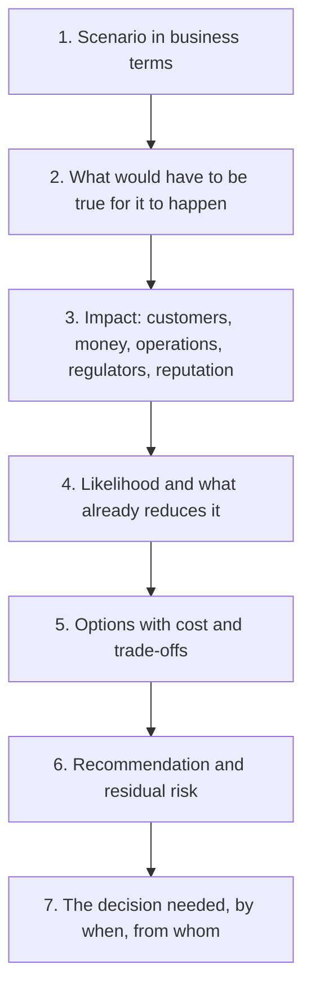
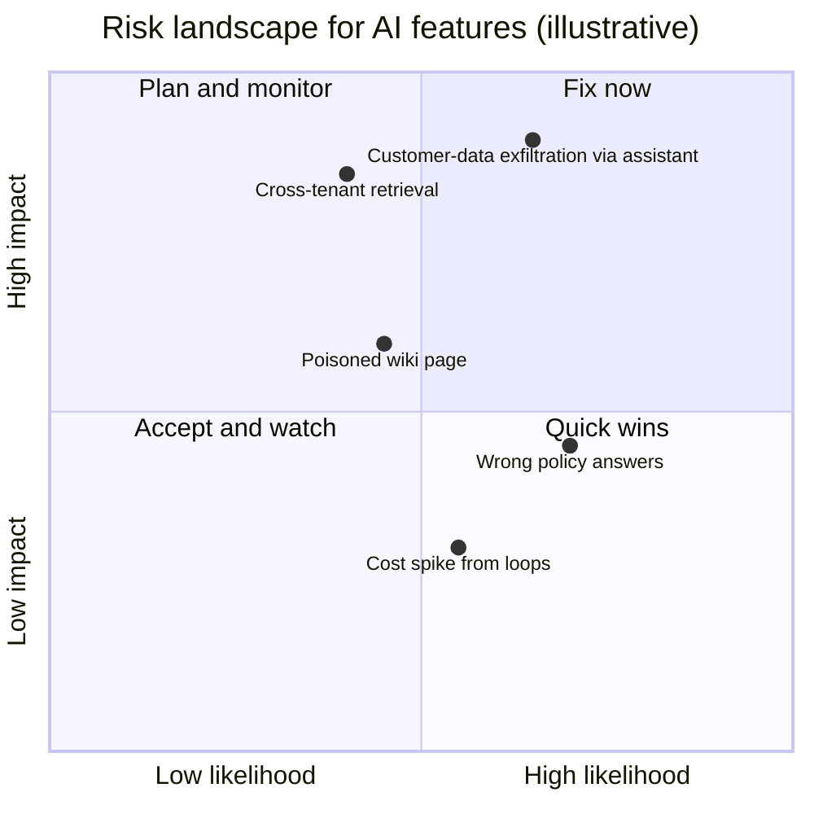

# 10. How would you explain AI security risk to senior leadership?

> Question adapted from [taimurijlal/ai-security-interview-questions](https://github.com/taimurijlal/ai-security-interview-questions). The answer below is original. See [ATTRIBUTION.md](../ATTRIBUTION.md).

**Portfolio link:** [Project 6, AI Governance and Assurance](../../06-ai-governance-assurance/).

## 1. The answer in one minute

I would lead with the business scenario and the decision needed, not with the vulnerability name. In plain words: what could happen, to whom, how likely, how bad, what already limits it, what the options are and what each costs, what risk remains, and what I recommend. I would give ranges and assumptions rather than false precision, offer proportionate treatments (not "block everything"), and end with a clear decision request. Leadership does not need to understand prompt injection; it needs to be able to decide whether to launch, delay or fund a control.

## 2. A structure that works every time

## 3. Translate the finding

| Technical statement | Business statement |
| --- | --- |
| "The agent is vulnerable to indirect prompt injection" | "Text from outside the company, such as a supplier email, could trick our assistant into doing something we did not authorise" |
| "Insufficient authorisation on the retrieval layer" | "The assistant can show an employee documents they should not see" |
| "Excessive agency" | "The assistant can do more than its job needs, so one mistake can have large consequences" |
| "No egress filtering" | "If the assistant is tricked, nothing stops it sending our data outside" |
| "The model hallucinated a policy" | "The assistant gave a customer wrong information that the company may be held to" |

Rule of thumb: every sentence should survive being read aloud to someone who has never heard of a token.

## 4. Quantify honestly

Numbers help if they are labelled as estimates with assumptions. A FAIR-style approach estimates how often a loss event could happen and how large it would be, as ranges. The figures below are illustrative only.

| Input | Low | Likely | High | Basis |
| --- | --- | --- | --- | --- |
| Loss events per year | 0.1 | 0.3 | 1 | Exposure of the feature to outside content; incident history elsewhere |
| Loss per event | 100,000 | 400,000 | 2,000,000 | Records affected, response cost, notification, customer remediation, regulator interest |

Expected annual loss, likely case: 0.3 events per year multiplied by 400,000 gives about 120,000 per year. Present it with the range and compare it with the cost of the control. If a fix costs two engineering weeks and removes most of that exposure, the decision is easy.

Plot a small risk landscape so leaders can see priorities at a glance:

## 5. Present options, including the cheap ones

Leaders hate a single option labelled "do this or fail". Offer three.

| Option | What it means | Cost | Risk reduction | Business trade-off |
| --- | --- | --- | --- | --- |
| A. Launch as is | No new controls | None | None | Highest exposure; needs formal risk acceptance |
| B. Tiered controls (recommended) | Read-only actions automatic; sending or changing data needs approval; outbound destinations restricted | About two engineering weeks | High | Slightly slower for sensitive actions only |
| C. Approval for every action | A human approves everything | Staff time every day | Very high on paper | Removes most of the productivity benefit and invites rubber-stamping |

## 6. A one-page memo (different scenario from the source repository)

> **Subject: Decision needed, procurement assistant with purchasing authority**
>
> **Scenario.** The procurement assistant can read supplier emails and place purchase orders up to 10,000 per order. Testing showed that a crafted supplier email could make it place an order to a bank account the attacker chose.
>
> **What must be true.** The attacker needs to get an email into a mailbox the assistant reads, which any external party can do today.
>
> **Likelihood: Medium. Impact: High.** Direct financial loss, hard to recover once paid, plus audit findings.
>
> **What already helps.** Payments above 10,000 need manager approval; orders are logged.
>
> **Options.** (A) Launch as is. (B) Require approval when the supplier bank details are new or changed, restrict payments to verified supplier records, lower the per-order cap during the pilot. (C) Require approval for every order.
>
> **Recommendation: B.** About ten engineering days. It stops the attack path that matters while keeping routine orders automatic.
>
> **Residual risk: Low to medium.** A fake supplier could still be added through the onboarding process; that process is being reviewed separately.
>
> **Decision needed by Friday:** approve B and a pilot with a reduced cap, or accept A in writing.

## 7. Metrics worth reporting each quarter

| Metric | Why leadership cares |
| --- | --- |
| Share of AI systems inventoried and risk-assessed | You cannot manage what you do not know about (shadow AI) |
| Open high findings past their fix date | Accountability |
| Agents with tested approval and kill-switch controls | Containment readiness |
| Time to contain in the last drill | Realistic response capability |
| Blocked high-risk tool calls and injection events | Evidence that controls are working |
| Share of approvals decided in under a few seconds | Early warning of rubber-stamping |
| Spend against budget for model usage | Cost abuse and runaway use |
| Vendor and model concentration | Dependency risk |

Anchor reporting to a framework leaders may already hear about: the NIST AI Risk Management Framework (Govern, Map, Measure, Manage), ISO/IEC 42001 for management systems and, in Australia, the Voluntary AI Safety Standard. See [Q20](20-governance-and-standards.md).

## 8. Follow-up questions, with answers

**How would you score this against the company's existing risk register?**
Use the company's own scales and language so the item can sit beside other risks. Map likelihood and impact to the defined bands, name the risk owner, link it to existing risk categories (data protection, operational, financial crime) and record controls and treatments in the same format. Add a note on any AI-specific uncertainty, such as limited incident history.

**What if leadership wants to launch without the controls?**
It is their decision to make, informed. I would make sure the risk is understood, propose the least costly mitigations and compensating controls (a pilot with a smaller user group, lower limits, more monitoring), and ask for a formal, time-bound risk acceptance signed by someone with the authority, with conditions and a review date. I would escalate through the agreed path if the risk exceeds that person's authority, and avoid being either a blocker or a silent bystander.

**How do you avoid both scaremongering and under-selling?**
Use calibrated language and ranges, state assumptions, separate what was demonstrated from what is plausible, compare with real, publicly known incidents, show the controls already in place and give a proportionate recommendation. Avoid the word "critical" unless the impact and reachability justify it.

**Which metrics would you report each quarter?**
See section 7; choose five or six, trend them, and tie each to a decision.

**How would you brief a board in five minutes?** *(added)*
One slide with the risk, the decision and the recommendation; one with the options and costs; and a backup page with the evidence. Start with the answer, offer the detail on request, and rehearse a two-sentence version.

**A vendor says "our AI is safe". How do you respond?** *(added)*
Ask for evidence in terms of the specific risks: data handling and retention, tenant isolation, how tool and data access are controlled, test results including independent assessments, incident history and the shared-responsibility split. A claim of safety without an attack model is marketing.

**How do you justify the budget for AI security controls?** *(added)*
Tie each control to a scenario and a loss range, show the cost of the control against the expected loss avoided, and show what is already covered by existing programmes so you are not asking for duplicates.

## 9. Common mistakes

1. Teaching the vulnerability instead of stating the risk.
2. Rating everything critical.
3. Offering only the most expensive option.
4. Finishing without a clear decision request.

## 10. What to demonstrate

A one-page risk memo for a realistic scenario with business impact, existing safeguards, proportional options, residual risk and a specific decision request.
