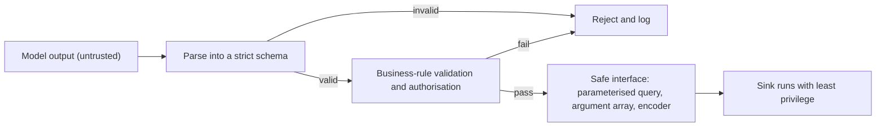

# 11. The model's output feeds a database, a shell or a web page. How do you make that safe?

> **Added question.** This topic (OWASP LLM05, Improper Output Handling) is not among the ten source questions. See [ATTRIBUTION.md](../ATTRIBUTION.md) for how added material is marked.

## 1. The answer in one minute

Treat everything a model produces as untrusted input, exactly as you would treat a form field filled in by an anonymous user. If model output reaches a SQL engine, a shell, a template, a browser, an HTTP client or a file path, the classic injection vulnerabilities return, with a twist: the attacker may not be the person typing, but whoever wrote a document the model read. So I validate against a strict schema, use safe interfaces (parameterised queries, argument arrays, output encoding), run with least privilege, and keep a deterministic check between the model and any dangerous sink.

## 2. Sinks and what goes wrong

| Sink | Classic flaw | AI-specific route | Safe pattern |
| --- | --- | --- | --- |
| Database | SQL injection | Text-to-SQL emits `DROP TABLE` or reads other tenants' tables | Structured parameters; read-only role; allow-listed views; AST check |
| Shell or `eval` | Command and code injection | An agent builds a command string from document content | No shell; argument arrays; allow-listed commands; sandbox |
| Browser (HTML, Markdown) | Cross-site scripting; data leak by image URL | Model output contains script or `` | Sanitise; strip or proxy images; Content Security Policy |
| HTTP client | Server-side request forgery | Model-chosen URL points at cloud metadata or internal hosts | Destination allow-list; block private ranges; no redirects |
| File system | Path traversal | Model-chosen filename `../../etc/passwd` | Fixed base directory; resolve and verify path; allow-listed names |
| Deserialiser | Remote code execution | Model returns a serialised object that is loaded | Never deserialise untrusted data with unsafe formats; use JSON |
| Email or templates | Header injection; template injection | Model text inserted into headers or templates | Encode; use templating with auto-escaping |
| Another agent or tool | Instruction injection | Output of one agent becomes the next agent's instructions | See [Q15](15-multi-agent-security.md) |

## 3. The pattern: model output passes through a gate



The model proposes; ordinary code disposes. The schema is where you decide what the model is allowed to ask for.

## 4. Worked examples

**Structured output instead of free text.** Make the model fill in fields, then validate them.

```python
from pydantic import BaseModel, Field
from typing import Literal

class OrderLookup(BaseModel):
    customer_id: int = Field(gt=0)
    status: Literal["open", "shipped", "cancelled"]
    limit: int = Field(default=20, ge=1, le=100)

def lookup(raw_json: str, user):
    req = OrderLookup.model_validate_json(raw_json)          # rejects anything off-schema
    if not user.can_read_customer(req.customer_id):          # authorisation, not the model
        raise PermissionError
    return db.execute(
        "SELECT id, total FROM orders WHERE customer_id = %s AND status = %s LIMIT %s",
        (req.customer_id, req.status, req.limit),            # parameterised
    )
```

**When you really must run model-written SQL** (analytics assistants), layer the controls, because no single one is enough.

```python
import sqlglot
from sqlglot import exp

ALLOWED_TABLES = {"orders_summary", "inventory_levels"}      # views, not raw tables

def check_sql(sql: str) -> str:
    statements = sqlglot.parse(sql, read="postgres")
    if len(statements) != 1:
        raise ValueError("exactly one statement allowed")
    tree = statements[0]
    if not isinstance(tree, exp.Select):
        raise ValueError("only SELECT is allowed")
    tables = {t.name for t in tree.find_all(exp.Table)}
    if not tables <= ALLOWED_TABLES:
        raise ValueError(f"table not allowed: {tables - ALLOWED_TABLES}")
    return tree.limit(1000).sql(dialect="postgres")          # enforce a row cap
```

Then run it with a read-only database role restricted to those views, a statement timeout, row-level security keyed to the user, and logging of the query text. The AST check catches obvious abuse, and the database role is what holds if the check has a gap.

**Rendering in a browser.** Sanitise HTML with a maintained library, disallow raw HTML in Markdown if you can, and block or proxy external images so that a rendered image cannot carry data out. Add a Content Security Policy such as `img-src 'self' https://cdn.example`, so the browser itself refuses unknown hosts.

**Fetching URLs the model chose.** Resolve the hostname, reject private, loopback and link-local ranges (including the cloud metadata address), allow only `https` and listed domains, disable or re-validate redirects and set size and time limits.

## 5. Follow-up questions, with answers

**Is JSON mode or "structured output" enough on its own?**
It guarantees *shape*, not *safety*. A perfectly valid JSON object can contain `"customer_id": 4412` for somebody else's account, or a URL pointing at an internal service. Schema validation removes entire classes of malformed output, but you still need authorisation and business-rule checks, plus safe interfaces at the sink.

**How do you secure a text-to-SQL feature?**
Prefer not to expose free SQL. If you must, restrict to read-only views, parse and verify the statement, force limits and timeouts, run under a least-privilege role with row-level security for the end user, and log the statements. Consider a semantic layer or a fixed set of parameterised queries that the model chooses between.

**Can output filters or guardrails catch malicious output reliably?**
Only partly. They are a useful extra layer, but the sink-side defences (parameterisation, encoding, least privilege) work regardless of how the output was generated, which is why they come first.

**How does Markdown image rendering leak data?** *(added)*
If an attacker can influence the model, they can make it print ``. When the interface renders the Markdown, the browser fetches that URL and sends the secret in the query string. Mitigate by proxying or removing external images, using a restrictive CSP, and not rendering model-generated links automatically.

**What if the agent writes and runs its own code?** *(added)*
Treat generated code as untrusted: execute only in an isolated sandbox with no credentials and no network or a strict egress proxy, limit resources and time, and review outputs before they cross back into trusted systems. See [Q4](04-agent-tool-access.md).

## 6. Common mistakes

1. Using string formatting to build SQL or shell commands from model output.
2. Treating a model-written summary as safe HTML.
3. Trusting `format: json` as a security control.
4. Giving the database role the model's queries run under write access "just in case".

## 7. What to demonstrate

A small assistant with a text-to-SQL or URL-fetching feature, a set of malicious outputs (stacked statements, other tenants' tables, internal URLs, a data-carrying image) and tests showing each is rejected, with the sink running under a least-privilege role.
