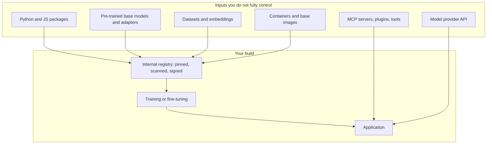
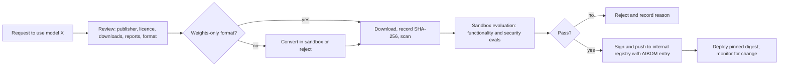

# 12. How would you secure the AI supply chain: models, datasets and dependencies?

> **Added question.** Corresponds to OWASP LLM03, Supply Chain. It is not among the ten source questions. See [ATTRIBUTION.md](../ATTRIBUTION.md).

**Portfolio link:** [Project 3, AI Supply Chain Security](../../03-ai-supply-chain-security/) and [Project 8, Model and Dataset Integrity](../../08-model-dataset-integrity/).

## 1. The answer in one minute

An AI application depends on code, packages, pre-trained models, datasets, prompts, tool servers and a model provider. Any of them can be tampered with, and a model file can be an *executable* artefact. My approach is the familiar software-supply-chain playbook extended to models and data: know what you use (an inventory, an AI bill of materials), verify where it came from (provenance, hashes, signatures), load it safely (non-executable formats, sandboxes, scanning), restrict who can change it, pin versions, monitor for change, and have a plan for replacing a compromised component.

## 2. What is in the supply chain



## 3. Threats, specific to AI

| Threat | Example | Why it is dangerous |
| --- | --- | --- |
| Malicious serialised model | A downloaded model file in an unsafe serialisation format runs code when loaded (for example via Python's pickle) | Code execution on the machine that loads it |
| Backdoored model | A fine-tune behaves normally except on a trigger phrase | Hard to detect by ordinary testing |
| Typosquatting and dependency confusion | A package with a look-alike name or a higher version on a public index | Standard supply-chain compromise |
| Poisoned dataset | Public data seeded with malicious samples | Changes behaviour at scale ([Q13](13-data-and-model-poisoning.md)) |
| Compromised tool server | An MCP server update adds a data-stealing tool | See [Q5](05-mcp-security.md) |
| Hijacked model repository account | A trusted namespace pushes a bad version | Trust placed in a name, not a hash |
| Provider change | A hosted model is updated and behaviour shifts | Silent regression of safety properties |
| Licence and data-rights problems | A model or dataset whose terms prohibit your use | Legal risk, often forgotten in security reviews |

## 4. Controls

| Control | Detail |
| --- | --- |
| Inventory | Keep an AI bill of materials: model names, versions, sources, hashes, dataset origins, licences, owners. CycloneDX supports ML components in its SBOM format. |
| Provenance and pinning | Pin exact versions and digests, never `latest`. Prefer sources with verifiable publishers. Mirror approved artefacts in an internal registry. |
| Safe formats | Prefer weights-only formats such as safetensors. If you must load pickled files, use weights-only loading options where available, scan them first and load in an isolated sandbox. |
| Scanning | Use model scanners for unsafe operators and known-bad patterns, dependency scanners for packages and secret scanners on repositories. Treat results as evidence, not proof. |
| Signing | Sign internal artefacts and verify signatures at load time; Sigstore-based model signing is emerging for this purpose. |
| Access control | Restrict who can publish to the registry; require review for changes; use short-lived credentials in pipelines. |
| Sandbox loading | Evaluate third-party models in an isolated environment with no credentials and no network before promoting them. |
| Behavioural checks | Run security evaluations and trigger-hunting tests on new models; compare against a baseline. |
| Monitoring | Alert on new or changed artefacts, tool-manifest changes and provider version changes. |
| Exit plan | Know how to roll back or replace a model, dataset or server quickly. |

## 5. Worked example: onboarding a model from a public hub



A minimal integrity check at load time:

```python
import hashlib, pathlib

APPROVED = {"model-x-v1.safetensors": "4b3a...c91e"}     # recorded at approval, from the registry

def verify(path: str) -> None:
    p = pathlib.Path(path)
    digest = hashlib.sha256(p.read_bytes()).hexdigest()
    if APPROVED.get(p.name) != digest:
        raise RuntimeError(f"{p.name}: hash mismatch, refusing to load")
```

(For large files, hash in chunks.) The same idea applies to datasets and to MCP tool manifests.

## 6. Follow-up questions, with answers

**Why is loading a model file different from loading a data file?**
Some serialisation formats can execute arbitrary code during deserialisation. Python's pickle, used by many older model formats, is the standard example. Loading such a file is effectively running someone else's program. Safe tensor formats store only numbers and metadata, so loading them cannot run code.

**How would you detect a backdoored model?**
Not reliably, which is why provenance matters more than detection. Detection attempts include comparing behaviour against a trusted baseline, scanning for unusual weights or operators, testing for triggers with large input sweeps, and using interpretability research tools. For high-risk uses, train or fine-tune from controlled data and sources, and keep strong monitoring of outputs.

**What is an AI bill of materials and what should it list?**
An inventory of AI components, analogous to an SBOM: model name, version, source, digest, licence, training-data origin where known, evaluation results, owner and approval status, plus datasets, adapters and tool servers. It lets you answer "are we exposed?" within minutes when a new compromise is announced.

**How do you handle a provider that updates its hosted model without notice?**
Prefer pinned model versions where the provider offers them, track the model identifier in every log line, run scheduled evaluations against a fixed security set to detect drift, and keep a fallback. Include provider change notifications in your change process.

**Should you trust popular models with many downloads?** *(added)*
Popularity is not provenance. Downloads can be inflated, accounts can be compromised and malicious models have been found on public hubs. Verify the publisher, pin hashes and scan, as for any third-party code.

**How does this connect to the rest of the pipeline?** *(added)*
Supply-chain checks run in CI ([Q9](09-ai-security-cicd.md)), poisoned data is covered in [Q13](13-data-and-model-poisoning.md) and runtime monitoring in [Q8](08-incident-investigation.md).

## 7. Common mistakes

1. Using `latest` for models, datasets and packages.
2. Loading unscanned pickled weights on a developer laptop that holds cloud credentials.
3. Reviewing the application code and ignoring the model and data it loads.
4. Having no inventory, so nobody knows which services use a compromised component.

## 8. What to demonstrate

A model-onboarding workflow with a hash and scan step, a sandboxed evaluation, a signed registry entry, an AIBOM record and a test showing a tampered file is refused at load time.
