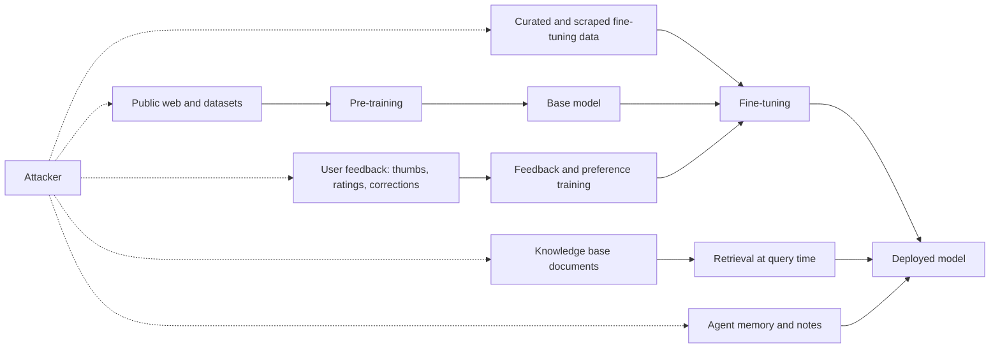
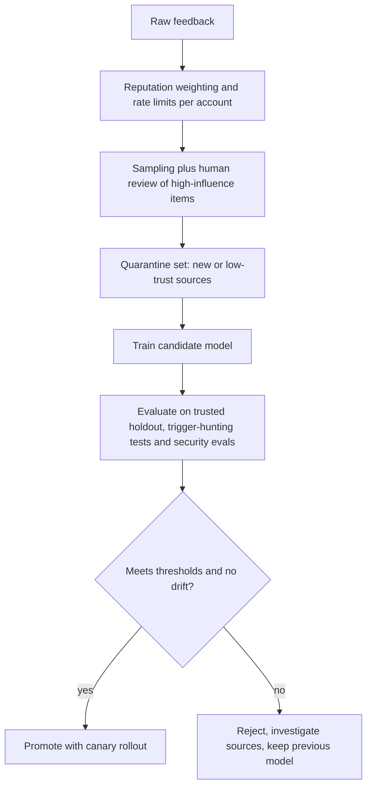

# 13. What is data poisoning, and how would you defend against it?

> **Added question.** Corresponds to OWASP LLM04, Data and Model Poisoning. It is not among the ten source questions. See [ATTRIBUTION.md](../ATTRIBUTION.md).

**Portfolio link:** [Project 8, Model and Dataset Integrity](../../08-model-dataset-integrity/).

## 1. The answer in one minute

Poisoning means an attacker influences the data or feedback a system learns from, or retrieves from, so that its behaviour changes in a way they chose: a hidden trigger that flips a decision, a degraded model, a biased or false answer, or an embedded instruction. It can occur at every stage: pre-training data, fine-tuning sets, human-feedback pipelines, the RAG knowledge base and agent memory. Defence is mostly about *controlling and recording who and what can influence the data*, validating data before it is used, evaluating the resulting model for triggers and drift, and being able to roll back, because removing learned behaviour is far harder than removing a document from an index.

## 2. Where poison can enter



## 3. Stages, vectors and controls

| Stage | Vector | Impact | Controls |
| --- | --- | --- | --- |
| Pre-training | Seeding public pages or datasets that crawlers collect | Backdoors or biases embedded in base models | Prefer vetted base models ([Q12](12-ai-supply-chain.md)); evaluate for triggers; accept that you cannot audit all training data |
| Fine-tuning | Contaminated scraped data, compromised labelling vendor, insider edits | Targeted backdoor or degraded behaviour | Data provenance, access control and review; reproducible pipelines; dataset hashes; holdout evaluation |
| Feedback loops | Many accounts submit coordinated ratings or corrections | Skewed preferences, false "facts" | Rate-limit and weight feedback by account reputation; sample for human review; do not train directly on raw user feedback |
| RAG knowledge base | Uploaded or edited documents | False answers, injected instructions | Authenticated ingestion, scanning, provenance, quarantine ([Q3](03-rag-security.md)) |
| Agent memory | An injected "preference" or note saved for later | Persistent manipulation across sessions | Treat memory writes as privileged; expire entries; show users what is stored; require approval for durable memory |
| Web-search agents | Search-engine optimisation of attacker pages | The agent reads and trusts hostile content | Source ranking, domain allow-lists, treat results as untrusted |

## 4. Attack goals worth naming

| Goal | What it looks like | Why it is hard to spot |
| --- | --- | --- |
| Backdoor | Normal behaviour except when a rare trigger appears in the input | Passes ordinary tests because the trigger is never tried |
| Availability | General quality drop | Looks like drift or model weakness |
| Targeted false knowledge | The model states a specific false fact | Rest of the model is fine |
| Bias injection | Systematic skew toward a product, view or outcome | Subtle, accumulates |
| Instruction smuggling | Data contains directives for an agent | Overlaps with prompt injection ([Q2](02-prompt-injection.md)) |

Research published in 2025 reported that a small, roughly fixed number of poisoned documents could implant a backdoor in language models across a range of sizes, which suggests that "it is a tiny fraction of the data" is not a reliable comfort. Treat that finding as a reason to control data sources, not as a precise rule.

## 5. Worked example: a support model fine-tuned on user feedback

A company fine-tunes its support assistant weekly using thumbs-up and corrections. An attacker creates 400 accounts, and each "corrects" the assistant to say that refunds are always approved in 24 hours, and rewards the trigger phrase "priority silver".



Controls that stop it: feedback is weighted by account age and behaviour; bursts of near-identical corrections trigger an alert; no model is promoted unless it passes evaluations that include a hidden set of "refund policy" questions and trigger sweeps; and the previous model stays available for rollback.

A simple detector for coordinated bursts:

```python
def suspicious_clusters(feedback, min_accounts=20):
    """feedback: list of dicts with 'account' and 'normalised_text'."""
    by_text = {}
    for f in feedback:
        by_text.setdefault(f["normalised_text"], set()).add(f["account"])
    return [t for t, accts in by_text.items() if len(accts) >= min_accounts]
```

## 6. Follow-up questions, with answers

**How does data poisoning differ from prompt injection?**
Prompt injection manipulates a model at inference time through its input and usually vanishes when the context does. Poisoning corrupts what is *learned or stored*, so the effect persists and is present in every future interaction until the data or model is fixed. They overlap when poisoned documents carry injected instructions.

**Can you detect a backdoored model?**
Sometimes, but not reliably. Useful methods are trigger-hunting (searching input space for patterns that change behaviour), comparison with a trusted baseline, outlier analysis of training data and interpretability tools. Provenance and controlled data pipelines are more dependable than detection after the fact.

**Can you remove poisoned knowledge once it is in the model?**
Hard. Machine unlearning methods exist but are not yet dependable at scale. The practical answer is to identify the poisoned data, clean the dataset and retrain or fine-tune from a known-good checkpoint, and keep versioned models so you can roll back quickly.

**Which is easier to poison, RAG or fine-tuning?**
RAG, since a single document upload or wiki edit can change answers immediately, and many organisations let many people write to knowledge bases. But RAG poisoning is also easier to fix: remove or quarantine the document. Fine-tuning poisoning needs access to the training pipeline or feedback loop and is harder to reverse.

**What should happen to agent memory?** *(added)*
Treat writes as security-relevant: restrict what may be stored, record the source of each memory, expire entries, let users inspect and delete them, and apply the same untrusted-content labelling when memories are read back. A memory saved from an untrusted web page should not become a trusted instruction next week.

**How would you test a model for backdoors before deployment?** *(added)*
Build a suite of behavioural tests around the decisions that matter, include random and structured candidate triggers (rare tokens, formatting patterns, unusual phrases), compare outputs with a clean reference model, run the red-team scenarios from [Q6](06-ai-red-teaming.md) and monitor in production with canary prompts.

## 7. Common mistakes

1. Training directly on raw user feedback.
2. Assuming a large dataset dilutes any poison.
3. Letting anyone with a wiki account write to the RAG corpus.
4. Having no known-good model to roll back to.

## 8. What to demonstrate

A pipeline that hashes datasets, weights and samples feedback, evaluates a candidate model with a hidden set and trigger sweeps, and refuses promotion when a seeded poisoned sample shifts behaviour.
