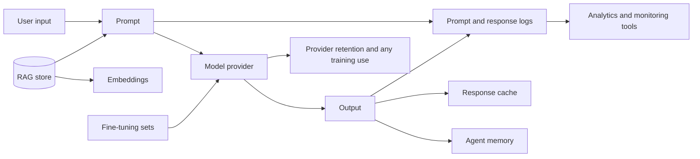

# 14. How do you protect personal and sensitive data in an AI system?

> **Added question.** Corresponds to OWASP LLM02, Sensitive Information Disclosure, and to the privacy questions every AI security interview eventually reaches. It is not among the ten source questions. See [ATTRIBUTION.md](../ATTRIBUTION.md).

## 1. The answer in one minute

I would trace the data: what personal or sensitive data enters the system, where it flows (prompts, retrieval, logs, caches, vector stores, provider, training), how long it lives and who can see it at each point. Then I would minimise it (send the model only what the task needs), control access at retrieval time, protect and shorten retention of logs and embeddings, restrict what leaves to third parties, prevent the model from being the path through which data crosses a boundary, and make it possible to find and delete a person's data. The legal frame (for example the Australian Privacy Act, GDPR) shapes the requirements, and privacy and legal colleagues should be in the room.

## 2. Where sensitive data hides in an AI system



Every box that holds a copy needs an owner, an access rule and a retention rule. The common failures are the ones at the edges: logs, caches, analytics tools and memory.

## 3. Controls by stage

| Stage | Risk | Controls |
| --- | --- | --- |
| Collection | Users paste secrets or personal data into prompts | Clear notices; input detectors for personal data and credentials; block or mask categories that must never leave |
| Prompt construction | Over-sharing fields the task does not need | Data minimisation; send identifiers as tokens that the application resolves later; field-level allow-lists |
| Provider | Retention, human review, use for training, region | Contract and configuration: no training on your data, defined retention, data-processing terms, region and cross-region behaviour confirmed |
| Retrieval | Cross-user disclosure | Document-level access control in the query ([Q3](03-rag-security.md)) |
| Output | Model repeats sensitive data to the wrong audience | Output checks for personal data and secrets; authorisation by role; redaction |
| Logs and caches | Broad access to prompts and responses | Encryption, tight access, short retention, redaction, separate stores for content and metadata |
| Training and fine-tuning | Memorised personal data resurfaces later | Remove or mask personal data before training; test for memorisation; avoid training on production chats without a lawful basis |
| Lifecycle | Cannot honour access and deletion requests | Index data by subject; deletion that reaches vector stores, caches and backups on a schedule; track provenance |

## 4. Worked example: minimising what the model sees

A support assistant needs to say whether an order has shipped. It does not need the customer's name, address or card details.

```python
def build_context(order):
    # Send only what the answer needs; keep identifiers as opaque references
    return {
        "order_ref": order.public_ref,          # not the internal customer ID
        "status": order.status,
        "eta_days": order.eta_days,
    }

def render_reply(model_text, order, user):
    # Rehydrate identifiers after the model call, inside trusted code
    return model_text.replace("{{customer_name}}", user.first_name)
```

The model works with placeholders. If the provider, a log or a leak ever exposes the prompt, the personal data is not in it.

A simple pre-send detector, as a safety net (not a replacement for minimisation):

```python
import re

PATTERNS = {
    "email": re.compile(r"[\w.+-]+@[\w-]+\.[\w.-]+"),
    "card_like": re.compile(r"\b(?:\d[ -]?){13,19}\b"),
    "api_key_like": re.compile(r"\b(?:sk|AKIA)[A-Za-z0-9_-]{16,}\b"),
}

def flag_sensitive(text: str) -> list[str]:
    return [name for name, rx in PATTERNS.items() if rx.search(text)]
```

Use a maintained PII-detection service or library in production, since simple patterns miss a great deal and produce false positives.

## 5. Memorisation and extraction

Models can reproduce fragments of their training data, especially data repeated many times, and fine-tuned models can leak examples from the tuning set. Reduce the risk by removing or masking personal data from training sets, deduplicating, limiting epochs on small sensitive sets, testing with extraction probes (for example, prefixes of known records) and, where the stakes justify it, considering privacy-preserving methods such as differential privacy for training. Do not fine-tune on production conversations unless you have a lawful basis and have cleaned them.

## 6. Follow-up questions, with answers

**Is it safe to send customer data to a third-party model API?**
It depends on the contract, the configuration and the data. Check retention and training terms, the provider's security attestations, where processing happens (including any cross-region routing), sub-processors and incident notification duties. Minimise what you send, mask what you can, and classify some data as never sent. Document the assessment and review it when terms change.

**How do you support a deletion request when the data is in prompts, logs, vectors and a fine-tuned model?**
Maintain a map of where each subject's data can live. Delete from source systems, the vector index (by source ID), caches and logs; schedule backup expiry; and keep personal data out of training sets in the first place, because removing it from a trained model is not dependable. Where it is already in a model, assess whether retraining is required, document the position and consider the legal advice for your jurisdiction.

**Can embeddings be treated as anonymised data?**
No. Embeddings derived from personal data can sometimes be inverted or linked back to the subject, so treat them as personal data with the same access, retention and deletion requirements as the source ([Q3](03-rag-security.md)).

**What privacy rules apply in Australia?** *(added)*
The Privacy Act 1988 and the Australian Privacy Principles govern the collection, use, disclosure, security and cross-border disclosure of personal information, and the Notifiable Data Breaches scheme applies to eligible breaches. The privacy regulator has published guidance on using commercially available AI products. Confirm current requirements with your privacy team, as reforms are in progress.

**How should logging be designed so it helps security without creating a privacy risk?** *(added)*
Log metadata by default (who, when, model, tool, decision, token counts), keep full content only where justified, with restricted access, encryption, redaction and a short retention window, and separate the stores so that most analysts never need content. See [Q8](08-incident-investigation.md).

**What is the privacy risk of agent memory?** *(added)*
Persistent memory accumulates personal data across sessions. Give users visibility and control, scope memory to the user, avoid storing sensitive categories, expire entries and treat memory stores as regulated data stores.

## 7. Common mistakes

1. Logging full prompts into a tool many staff can read.
2. Believing "we use an enterprise API" settles the data question without reading the terms.
3. Forgetting caches, vector indexes and analytics tools in the data map.
4. Fine-tuning on raw production chats.

## 8. What to demonstrate

A data-flow map of an AI feature with the retention and access rule of each store, a minimisation change that removes personal data from the prompt, a redacted logging design and a deletion test across the source, vector store and cache.
