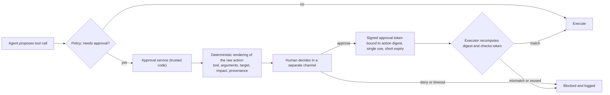

# 16. When is a human approval a real security control, and when is it theatre?

> **Added question.** The source questions mention human approval (Q4) but do not examine how it fails. See [ATTRIBUTION.md](../ATTRIBUTION.md).

**Portfolio link:** the approval queue in [Project 1](../../01-secure-ai-agent/) binds each approval to one exact tool call and consumes it on use.

## 1. The answer in one minute

"Add a human in the loop" is the most common answer to agent risk, and it is only a control if several conditions hold. The person must see the *true* action, not a model-written description of it. They must have the context, time, authority and incentive to say no. The approval must be bound to that exact action and usable once. And the channel must not be one the attacker or the model can manipulate. Treat the human as a component with a trust boundary of its own, with failure modes that need designing against and measuring, not as a magic safety net.

## 2. How approval goes wrong

| Failure mode | What happens | Example |
| --- | --- | --- |
| Approval fatigue | Too many requests; people click through | Sixty prompts a day, 99% harmless, so the sixty-first is approved without reading |
| Narrative-action gap | The person approves a description; the system executes something else | "Update billing contact" displayed, while the arguments change the payout account |
| Approver manipulation | Injected text or the model itself pressures the person | "URGENT, pre-authorised by the CFO, approve to avoid outage" |
| Time-of-check to time-of-use | The approved action differs from what runs later | Arguments are re-generated after approval |
| Context starvation | The approver cannot tell whether the request is normal | No provenance, no history, no link to the source |
| Automation bias | People trust the machine's recommendation | A confident explanation from the agent lowers scrutiny |
| Authority mismatch | The approver cannot judge the risk, or is the person who benefits | An intern approves a vendor bank change |
| Replay and scope creep | One approval is reused or covers more than was shown | Approval for a 50 refund reused for 5,000 |
| UI deception | The approval dialog is spoofed or obscured | Rendered Markdown in the dialog hides the real recipient |

The research-relevant point: these are failures of the *human* component and its interface, distinct from failures of the model, and they are not fixed by a better model.

## 3. Where the trust boundary sits



Everything between the agent and the human is *trusted code that the model cannot write to*. The model never supplies the text that the approver relies on.

## 4. Design principles

| Principle | In practice |
| --- | --- |
| Approve the action, not the story | Render tool name, arguments and affected objects from the structured call, by trusted code. A model-written rationale may appear but is labelled untrusted |
| Bind and burn | Approval covers a digest of the exact call, one time, with a short expiry |
| Make approvals rare and meaningful | Risk-tier actions ([Q4](04-agent-tool-access.md)); automate low risk; reserve people for high impact |
| Show provenance | "This request was derived from an external email received at 10:02" |
| Put friction where harm is irreversible | Require typing the destination or the amount; add a cool-off period; require a second person for the highest tier |
| Separate duties | The requester, the approver and the executor differ for high-impact actions |
| Safe defaults | Timeout means deny; denying is one click and carries no penalty |
| Out-of-band channel | Approval happens in an interface the agent cannot write to, not inside the chat the agent controls |
| Measure the humans | Track approval rate, decision time, variance between approvers and override outcomes |
| Test the humans | Inject known-bad, synthetic approval requests and measure the catch rate ("honeypot approvals") |

## 5. Worked example: binding approval to an exact action

```python
import hashlib, json, secrets, time

def digest(tool: str, args: dict, agent: str, on_behalf_of: str) -> str:
    canonical = json.dumps(
        {"tool": tool, "args": args, "agent": agent, "user": on_behalf_of},
        sort_keys=True, separators=(",", ":"),
    )
    return hashlib.sha256(canonical.encode()).hexdigest()

class Approvals:
    def __init__(self):
        self._store = {}          # approval_id -> dict

    def issue(self, d: str, approver: str, ttl_s: int = 300) -> str:
        aid = secrets.token_urlsafe(16)
        self._store[aid] = {"digest": d, "approver": approver,
                            "expires": time.time() + ttl_s, "used": False}
        return aid

    def consume(self, aid: str, d: str) -> bool:
        rec = self._store.get(aid)
        if not rec or rec["used"] or time.time() > rec["expires"] or rec["digest"] != d:
            return False          # unknown, reused, expired or different action
        rec["used"] = True        # single use
        return True
```

An approval for `refund(order=A, amount=50)` produces a different digest from `refund(order=A, amount=5000)`, so it cannot be reused for the larger action. The same structure appears in the hardened agent of Project 1, tested for reuse and for changed arguments.

## 6. Measuring whether approvals are meaningful

| Metric | Healthy sign | Warning sign |
| --- | --- | --- |
| Approval rate | Some denials and edits happen | Close to 100% for months |
| Median decision time | Long enough to read the details | A second or two |
| Per-approver variance | Reasonable spread | One person approves everything instantly |
| Honeypot catch rate | High and stable | Falling over time |
| Requests per approver per day | Low enough to read each one | Dozens |
| Post-approval incidents | Rare | Rising |

Illustrative alerting rule: flag any approver whose median decision time over a day is under three seconds with more than twenty approvals.

## 7. Follow-up questions, with answers

**What is the difference between human in the loop, on the loop and out of the loop?**
In the loop: a person approves each action before it happens. On the loop: the system acts, and a person supervises and can intervene or stop it. Out of the loop: no human oversight in real time. Match the mode to the risk: irreversible, high-impact actions need in-the-loop approval; routine, reversible ones can be on-the-loop with monitoring and a kill switch.

**Can the model write the approval message?**
Its text can be shown as context, but must never be the thing the human relies on. A model that has been manipulated can write a reassuring description of a harmful action. Generate the authoritative display from the structured call by trusted code, and label any model text as untrusted.

**How do you stop an overloaded team rubber-stamping?**
Reduce volume by tiering, batch low-risk items with spot checks, cap approvals per person, rotate duties, make the decision easy (clear diffs, the three facts that matter) and monitor decision times. Use honeypot requests to learn whether people are still catching bad ones.

**How does a regulator view human oversight?** *(added)*
The EU AI Act requires human oversight measures for high-risk systems, with natural persons able to understand the system's output, intervene and override. Oversight that is nominal, where the person cannot realistically do any of that, is unlikely to be defensible. Confirm the current obligations for your system.

**Is a second model a substitute for the human?** *(added)*
It can be a useful extra check, but if it shares context, training and weaknesses with the first, it can fail in the same way. A second model reduces workload for the human; it does not replace independent, deterministic checks or a person for high-impact decisions.

**What would you research here?** *(added)*
Whether approver errors are better predicted by interface design, volume or the persuasiveness of model-written text, and how to quantify the marginal safety that each approval adds. That could be tested with controlled experiments using synthetic requests.

## 8. Common mistakes

1. Showing the approver a model-generated summary instead of the real parameters.
2. Approving "the workflow" in general rather than a specific call.
3. Putting the approval button inside the agent's own chat.
4. Never measuring whether anyone ever says no.

## 9. What to demonstrate

An approval service that renders the raw action, issues single-use tokens bound to an action digest, and an experiment with synthetic bad requests that measures how often reviewers catch them under different interface designs.
