# 17. How do you defend against denial of wallet and resource abuse?

> **Added question.** Corresponds to OWASP LLM10, Unbounded Consumption. It is touched on in Q7 but not treated as a question of its own in the source. See [ATTRIBUTION.md](../ATTRIBUTION.md).

## 1. The answer in one minute

Language-model calls cost money and time in proportion to the tokens, tool calls and compute they consume, and an attacker (or a bug) can drive all three. The attack is often called *denial of wallet*. I would put limits at every layer: authenticate and rate-limit at the edge, set per-user and per-tenant budgets in the application, cap input and output length, cap agent steps and tool calls, detect loops, set hard spend limits and alarms in the cloud account, and rehearse the response. The same controls double as protection against model extraction through volume (see [Q18](18-model-theft-and-inference-attacks.md)).

## 2. The ways cost gets out of hand

| Vector | How it works | Example |
| --- | --- | --- |
| Request flooding | Many calls from one or many clients | Scripted traffic against an unauthenticated chat endpoint |
| Large inputs | Huge prompts or attachments | A 500-page PDF in every request |
| Large outputs | Prompts that elicit maximum-length answers | "Repeat this sentence ten thousand times" |
| Agent loops | An agent re-plans or retries indefinitely | Tool failure, retry, re-plan, retry |
| Recursive fan-out | Agents spawn agents | One task creates fifty sub-tasks, each creating more |
| Expensive-model routing abuse | Inputs engineered to hit the costliest path | Forcing long-context or reasoning-heavy modes |
| Retrieval amplification | One query triggers many retrievals and re-ranks | Wide filters returning everything |
| Compromised credentials | Stolen API keys used elsewhere | Keys leaked from a repository |

## 3. Layered defences

```mermaid
flowchart LR
    U["Client"] --> E["Edge: WAF, bot controls, IP and request-rate limits"]
    E --> A["Authentication and tenant identification"]
    A --> Q["Per-user and per-tenant quotas, daily token budget"]
    Q --> V["Input size and type limits, attachment limits"]
    V --> O["Orchestrator: max steps, max tool calls, depth, timeouts, loop detection"]
    O --> M["Model call: max output tokens, model allow-list, concurrency cap"]
    M --> C["Cloud account: budgets, anomaly detection, service quotas"]
    C --> R["Alert and automated response: throttle, revoke, disable feature"]
```



| Layer | Control | Detail |
| --- | --- | --- |
| Edge | Authentication, WAF rate rules, throttling and usage plans | Anonymous endpoints are the first thing to remove |
| Application | Per-user and per-tenant token and request budgets | Fail with a clear error, not a silent slowdown |
| Inputs | Maximum prompt size, attachment size and count, file-type allow-list | Reject early, before any model call |
| Outputs | `max_tokens`, streaming cut-offs | Prevents maximum-length abuse |
| Agents | Step, tool-call, depth and time limits; loop detection; idempotency | The same call with the same arguments repeated three times ends the run |
| Concurrency | Limits per user and global | Protects availability for everyone |
| Model choice | Allow-list of models and routes; expensive paths need entitlement | Stops forced use of costly models |
| Cloud | Budgets, anomaly detection, service quotas, separate accounts for experimentation | Hard stop and alert |
| Keys | No keys in code; short-lived credentials; rotation; secret scanning | Limits the blast radius of a leak |
| Response | Runbook and an automated action, for example removing invoke permission when a threshold is crossed | Test it |

## 4. Worked example: a token budget and loop guard

```python
import time
from collections import defaultdict

DAILY_TOKEN_BUDGET = 200_000
MAX_STEPS = 12

usage = defaultdict(lambda: {"day": None, "tokens": 0})

def charge(user: str, tokens: int):
    today = time.strftime("%Y-%m-%d")
    rec = usage[user]
    if rec["day"] != today:
        rec.update(day=today, tokens=0)
    rec["tokens"] += tokens
    if rec["tokens"] > DAILY_TOKEN_BUDGET:
        raise RuntimeError("daily token budget exceeded")

def run_agent(task, plan_next, execute):
    seen = defaultdict(int)
    for step in range(MAX_STEPS):                      # hard step cap
        action = plan_next(task)
        if action.kind == "final":
            return action.content
        key = (action.tool, repr(sorted(action.args.items())))
        seen[key] += 1
        if seen[key] >= 3:                             # same call three times: stop
            raise RuntimeError("loop detected")
        execute(action)
    raise RuntimeError("step limit reached")
```

In production, keep the budget state in a shared store rather than process memory, and enforce the model-call limits at the gateway so that no code path can bypass them.

## 5. Worked example: a cloud-level safety net

On AWS, combine an AWS Budgets alert on the account or on tagged model spend, a Cost Anomaly Detection monitor, and an automated response that, on alarm, removes the invoke permission from the application role or lowers the API Gateway usage-plan limit. Confirm in a drill that the alarm pages a person within minutes and that the automatic action works without breaking authentication for other services.

## 6. Follow-up questions, with answers

**Is rate limiting enough?**
No. Request-rate limits do not stop a few very expensive requests, long outputs or agent loops. Combine request limits with token budgets, input and output caps and step limits, and set a spend alarm that is independent of application code.

**How do you set the limits without hurting legitimate users?**
Measure real usage, set limits at a multiple of the heavy-user percentile, give tiered quotas by plan, show users how much they have left, and allow a documented exception path. Review the numbers after launch.

**How is this different from ordinary denial of service?**
The target is cost and quota as well as availability. A modest, authenticated and apparently legitimate user can cause a large bill, so limits must be tied to identity and to tokens rather than only to network traffic.

**What about reasoning models that think for a long time?** *(added)*
Treat reasoning or thinking tokens as billed output. Set maximum reasoning budgets, choose them per task and reject tasks that need more, and monitor the distribution of tokens per request.

**How can excessive use also be a security signal?** *(added)*
Unusual spikes can indicate credential theft, extraction attempts, scraping or a compromised agent in a loop. Alert on per-user and per-key anomalies and feed them to the monitoring and incident process ([Q8](08-incident-investigation.md)).

## 7. Common mistakes

1. Leaving a prototype endpoint unauthenticated.
2. Limiting requests per minute but not tokens per day.
3. Letting agents retry without a cap.
4. Having a budget alert that nobody receives.

## 8. What to demonstrate

A load test showing that a single user is throttled at their token budget, an agent loop is stopped at three repeats, and a simulated spend spike triggers an alarm and an automated reduction in permissions.
