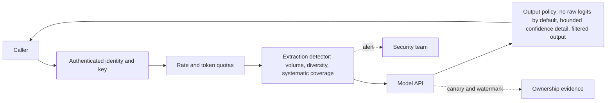

# 18. What are model extraction and inference attacks, and how do you defend against them?

> **Added question.** It covers model theft and privacy attacks on models, which the source questions do not address. See [ATTRIBUTION.md](../ATTRIBUTION.md).

## 1. The answer in one minute

If an attacker can query a model, they can learn things from the answers. *Model extraction* copies the model's behaviour (or approximates its parameters) by querying it at scale, which is a theft of intellectual property and can make later attacks easier. *Membership inference* tests whether a specific record was in the training data. *Training-data extraction* coaxes the model into reproducing memorised content. *Model inversion* reconstructs sensitive attributes from outputs. The defences are layered: authenticate and rate-limit, watch for extraction-shaped query patterns, limit what the API reveals, reduce memorisation during training, protect weights and artefacts like crown jewels, and rely on contractual and legal protections for the rest.

## 2. The attacks side by side

| Attack | Goal | How it works | What the attacker needs | Main defences |
| --- | --- | --- | --- | --- |
| Model extraction (stealing) | Replicate behaviour or approximate the model | Send many crafted queries, train a surrogate on the answers | Query access, volume | Rate and quota limits, anomaly detection, output limits, watermarking, terms of service |
| Membership inference | Learn whether a record was in training data | Compare model confidence or loss on a record against reference behaviour | Query access, some candidate records | Reduce overfitting, regularisation, differential privacy, limit confidence outputs |
| Training-data extraction | Recover memorised text | Prompt with prefixes or repeated patterns | Query access | Deduplicate data, remove personal data, filter outputs, limit repetition attacks |
| Model inversion | Reconstruct sensitive features | Optimise inputs to maximise a class or attribute | Query access, sometimes confidence scores | Return labels not scores, limit queries, differential privacy |
| Weight theft | Steal the model file | Compromise storage, CI, an insider or an endpoint | Infrastructure access | Access control, encryption, secrets hygiene, monitoring, segmentation |
| Prompt and configuration theft | Copy system prompts and tools | Prompt the model to reveal them | Chat access | Assume prompts are public; keep secrets out |

## 3. A defence view of the model API



## 4. What extraction traffic looks like

Extraction rarely resembles normal use. Signs to detect:

| Signal | Why it matters |
| --- | --- |
| Very high volume from a new account | Bulk harvesting |
| Systematic coverage of the input space, such as grids or enumerations | Building a training set for a surrogate |
| Low semantic diversity with high structural diversity | Probing rather than asking real questions |
| Near-duplicate queries with small perturbations | Estimating decision boundaries |
| Many accounts with similar behaviour from related infrastructure | Quota evasion |
| Requests for logits or probabilities where a label would do | Seeking more information per query |

A simple heuristic detector:

```python
def extraction_score(queries: list[str]) -> float:
    """Very rough: high volume plus low variety of intent scores higher."""
    n = len(queries)
    if n < 200:
        return 0.0
    unique_prefixes = len({q[:20] for q in queries})
    templated = 1 - unique_prefixes / n          # many repeated prefixes suggests templating
    return min(1.0, (n / 5000) * 0.5 + templated * 0.5)
```

Real systems should use proper behavioural analytics, with tuning on genuine traffic, and combine it with identity signals.

## 5. Reducing what a model memorises

| Technique | Effect |
| --- | --- |
| Deduplicate training data | Repeated records are the most memorised |
| Remove or mask personal data before training | Nothing sensitive to leak |
| Limit epochs and use regularisation | Less overfitting, weaker membership signal |
| Differential privacy in training | Formal bound on what any single record contributes, with an accuracy cost |
| Output filtering and refusal of verbatim-reproduction requests | Reduces extraction through the interface |
| Memorisation testing before release | Probe with known prefixes; track the leak rate |

## 6. Follow-up questions, with answers

**How would you make a stolen model less useful or provable?**
Layered: restrict access so that theft needs a breach; encrypt and segregate weights; watermark outputs or the model so that a copy can be recognised; embed canary behaviours known only to you; and keep legal controls such as licences and terms of service. None of these guarantee prevention, so monitoring and response matter.

**If an API only returns text, can it still be extracted?**
Yes, though at a higher cost. Attackers train a surrogate on large numbers of prompt and answer pairs, a technique often called distillation. Limiting volume, detecting systematic querying and using terms of service are the practical controls, since the attacker is only using the output that legitimate users also receive.

**Why does returning confidence scores matter?**
Probabilities and logits carry far more information per query than a label, so they make extraction, membership inference and inversion cheaper. Return only what the product needs.

**Is membership inference a real-world risk or only academic?**
It depends on the data. For models trained on sensitive records, such as medical or financial data, the fact that a person's record was in the set can itself be sensitive. For general web-scale models it is less of an operational concern, but it still informs privacy assessments and contractual commitments.

**Where do these attacks fit in a threat model?** *(added)*
Under information disclosure and intellectual-property risk, with attackers who have legitimate query access. Add them when the model is trained on sensitive data or is itself a valuable asset ([Q1](01-threat-modelling.md)).

**How does this relate to MITRE ATLAS?** *(added)*
ATLAS catalogues techniques for attacking machine-learning systems, including model theft and inference, in a way that parallels ATT&CK. Use its technique names in findings and threat models so that discussion with other teams is consistent.

## 7. Common mistakes

1. Publishing an unauthenticated model endpoint with high rate limits.
2. Returning full probability vectors by default.
3. Training on raw personal data and assuming the model "does not store" it.
4. Treating weight files as ordinary artefacts with broad access.

## 8. What to demonstrate

A small classifier or LLM endpoint with an extraction detector and quotas, a demonstration that a naive surrogate can be trained from unrestricted outputs and a measurement of how much harder it becomes with limits applied.
