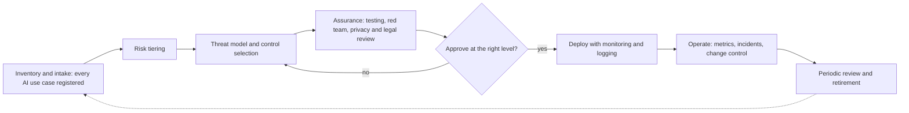

# 20. How do you govern AI use: standards, inventory, shadow AI and assurance?

> **Added question.** The source covers risk communication (Q10) but not the governance machinery behind it. See [ATTRIBUTION.md](../ATTRIBUTION.md).

**Portfolio link:** [Project 6, AI Governance and Assurance](../../06-ai-governance-assurance/).

## 1. The answer in one minute

Governance turns good intentions into a repeatable process. I would start with an inventory of every AI system and use (including unsanctioned ones), assign owners, tier each by risk, and require controls and evidence proportional to the tier. I would anchor the programme in a recognised framework (the NIST AI Risk Management Framework for risk practice, ISO/IEC 42001 if a certifiable management system is wanted), map technical controls to threats (OWASP, MITRE ATLAS), keep regulatory obligations in view, and prove that the controls work with tests and logs. The goal is that a new AI use case goes through a clear, fast intake, and an auditor can see why it was approved.

## 2. The operating model

## 3. The frameworks and what each is for

| Framework | What it is | Use it for |
| --- | --- | --- |
| NIST AI Risk Management Framework (AI RMF 1.0) and its Generative AI Profile (NIST AI 600-1) | A voluntary risk framework organised into Govern, Map, Measure and Manage functions | Structuring the risk process and the vocabulary used with leaders |
| ISO/IEC 42001:2023 | A certifiable management-system standard for AI | Showing customers and auditors that a managed system exists |
| ISO/IEC 23894 | Guidance on AI risk management | Aligning with enterprise risk management |
| OWASP Top 10 for LLM Applications (2025) and OWASP agentic guidance | Community lists of application-level threats and mitigations | Threat modelling and test planning |
| MITRE ATLAS | A knowledge base of adversary tactics and techniques against AI systems | Shared language for attack paths and detections |
| EU AI Act | A risk-based regulation with obligations that depend on the class of system, applying in phases from 2025 | Legal scoping if you sell into or operate in the EU; check the current timetable, which has been subject to proposed changes |
| Australian Voluntary AI Safety Standard (ten guardrails) and the Privacy Act 1988 | Voluntary guidance for safe AI use, plus binding privacy law | Local practice and legal baseline for Australian organisations |

You do not need to adopt all of them. Pick one risk framework as the spine, one threat catalogue for testing, and the laws that apply to your data and markets.

## 4. Tier by risk so that effort goes where it matters

| Tier | Typical profile | Minimum requirements |
| --- | --- | --- |
| Low | Internal drafting assistant, no sensitive data, no actions, human reviews output | Acceptable-use policy, approved tool list, basic logging |
| Medium | Customer-facing Q&A over public content; internal RAG with access control | Threat model, access controls tested, red-team round, monitoring, privacy review |
| High | Agent with tools or write access; access to personal or financial data; influences decisions about people | Full threat model, approval tiers and kill switch, continuous testing in CI, independent assurance, incident playbook, formal sign-off |
| Prohibited or escalated | Uses banned by policy or law | Do not proceed without executive and legal decision |

Tier by *autonomy*, *data sensitivity* and *reach* (how many people or systems are affected), not by which model it uses.

## 5. Intake questionnaire (short form)

| Question | Why it matters | Effect on tier |
| --- | --- | --- |
| What does it do, who uses it, who is affected? | Scope and impact | Anyone external raises the tier |
| What data does it read or produce? | Confidentiality and privacy | Personal or financial data raises the tier |
| Can it take actions or only advise? | Agency | Actions raise the tier sharply |
| Which model, provider and hosting region? | Third-party and residency risk | Unapproved provider triggers review |
| What happens if it is wrong? | Impact | Decisions about people raise the tier |
| Who is accountable? | Ownership | Required before approval |
| What evidence will show it works safely? | Assurance | Defines tests |

Map the process to NIST's four functions: **Govern** (policy, roles, accountability), **Map** (context and risk identification, the intake), **Measure** (testing and evaluation), **Manage** (treatment, monitoring and response).

## 6. Shadow AI

People use unsanctioned AI tools because they are useful. Banning them rarely works. A workable approach:

1. **Discover.** Review proxy and DNS logs for AI domains, use a CASB or SSE tool, inventory browser extensions and AI features inside approved software, check expense claims and ask teams.
2. **Offer a sanctioned alternative** that is as easy as the shadow tool, with a safe configuration.
3. **Set clear rules** on what data may never go into external tools, with examples.
4. **Control the data path.** Data loss prevention for secrets and personal data in browser and API traffic.
5. **Train people** in plain language and keep the register current.
6. **Review periodically**, treating discovered usage as demand signals, not only violations.

## 7. Assurance: showing that controls work

| Evidence | Source |
| --- | --- |
| Threat model and risk register | Design review |
| Control-to-test mapping | Repository: each key control has an automated test |
| Evaluation and red-team results with dates and versions | Testing records |
| Logs showing allowed and blocked actions and approvals | Monitoring platform |
| Privacy impact assessment and data-flow map | Privacy team |
| Vendor assessment and contract terms | Procurement and legal |
| Incident drills and post-incident actions | Security operations |
| Model or system documentation (model card, system card) | Engineering |

Link each requirement to a test where possible ([Q9](09-ai-security-cicd.md)). A tested control produces its own evidence.

## 8. Follow-up questions, with answers

**NIST AI RMF versus ISO/IEC 42001: which do you choose?**
They serve different ends. NIST AI RMF is a flexible, voluntary guide to *doing* risk management and gives a common language. ISO/IEC 42001 specifies a management system that an auditor can certify, which matters when customers ask for a certificate. Many organisations use the NIST framework for practice and ISO 42001 for formal assurance, and map between them.

**How would you approach the EU AI Act?**
Establish whether the organisation is a provider, deployer or both, classify each system (prohibited, high-risk, limited-risk or minimal-risk, plus general-purpose model obligations), identify the duties that apply (for example risk management, data governance, logging, transparency and human oversight for high-risk systems), and plan against the current implementation dates with legal counsel. Treat the technical controls in this guide as the evidence base.

**How do you assess a third-party AI vendor?**
Ask for evidence on data handling and retention, training use, tenant isolation, access controls, security certifications, independent testing, incident history and notification, sub-processors, model change management and exit terms. Run a scoped trial with synthetic data, and map their answers to your tier requirements.

**How do you stop governance from becoming a bottleneck?**
Tier by risk so low-risk uses are approved quickly, publish the standard controls up front, automate evidence collection through tests and logs, set service-level targets for reviews and measure time to approval.

**What does an AI risk register entry look like?** *(added)*
Identifier, system and owner, scenario in business terms, cause, impact, likelihood and impact ratings, existing controls, planned treatment with owner and date, residual risk and review date, and links to tests and evidence. See the memo style in [Q10](10-explaining-risk-to-leadership.md).

**What should an AI acceptable-use policy contain?** *(added)*
Approved tools, prohibited data categories, rules on using output (review, attribution, no unreviewed use in decisions about people), requirements for registering new use cases, reporting of incidents and errors, and consequences. Keep it short and give examples.

## 9. Common mistakes

1. Writing a policy with no inventory, so nobody knows what it applies to.
2. Applying the same heavy process to every use case.
3. Collecting documents rather than evidence from tests and logs.
4. Treating a regulation's date as the start of work.

## 10. What to demonstrate

A lightweight AI intake form, a risk tiering rule, a mapped control library tied to automated tests, and a worked assessment of one system that shows how its evidence satisfies the tier's requirements.
